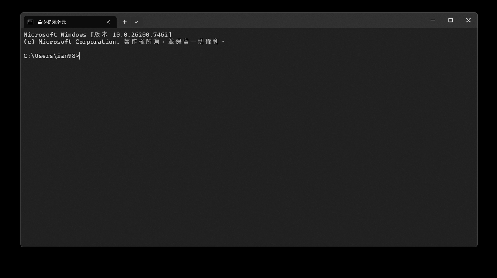
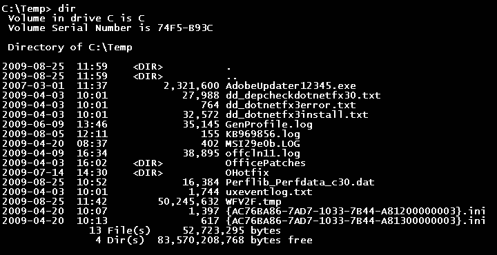

# 共用基础篇：用 AI 编程助手前，先懂这 5 个概念

> 这是「AI 编程助手图文教程」系列的**共用基础篇**。
> 无论你接下来学 [OpenCode](opencode.md) 还是 [Codex](codex.md)，都请先花 10 分钟读完这一篇。
> 它不讲任何具体软件，只讲所有 AI 编程助手都绕不开的基础概念。

---

## 写给谁看

如果你符合下面任意一条，这一篇就是为你写的：

- 你听说过"AI 能帮忙写代码 / 做网页"，但完全不知道从哪开始。
- 你打开过一些教程，里面写着 `/**`、`npm`、`API Key`，但**没告诉你这些到底是什么意思，更没演示怎么用**。
- 你用的是 **Windows** 电脑（本系列以 Windows 为主）。
- 你想亲手做出一个能运行的小东西，而不是只看别人演示。

## 阅读约定

教程里会出现几个固定图标，先认识一下：

| 图标 | 含义 |
| --- | --- |
| 📷 | 这里配了一张（真实）截图。截图清单见 [`assets/README.md`](assets/README.md) |
| 💡 | 小提示，能让你更省事 |
| ⚠️ | 容易出错的地方，重点看 |
| 🧪 | 动手练习，有明确的"验收标准" |

另外，凡是你能照着敲的命令，都会放在灰色代码块里，比如：

```bash
ls
```

**你只需要把代码块里的内容，原样敲进终端，然后按回车。** 就这么简单。

---

## 1. 终端到底是什么？

**"终端"（Terminal）就是一个人对着电脑打字的窗口。**

平时我们用电脑是"点鼠标、点图标"；终端则是"打字告诉电脑做什么"。它长得像一个黑底（或白底）的方框，里面有一行一行的字。

> 
>
> 📷 图（来源：Wikimedia Commons，公有领域，作者 Microsoft）—— 真实的 Windows 11 命令提示符界面，光标处就是等你输入命令的位置。

**在 Windows 上怎么打开终端？**

方法一（最简单）：
1. 按键盘上的 `Win` 键（窗口图标键）。
2. 直接打字 `终端` 或 `powershell`。
3. 点搜索结果里的「终端」或「Windows PowerShell」。

方法二：
1. 在桌面或文件夹里，按住 `Shift` 点鼠标右键。
2. 选择「在此处打开 PowerShell 窗口」或「在终端中打开」。

打开后你会看到一个窗口，里面可能显示类似：

```
PS C:\Users\你的名字>
```

这行字叫**提示符**，意思是"我准备好了，请输入命令"。`C:\Users\你的名字` 表示你**当前所在的位置（文件夹）**。

## 2. 命令是什么？`$` 又是什么？

**"命令"就是你敲给电脑的一句话。** 比如"列出当前文件夹有什么"。

在很多教程里你会看到这样的写法：

```bash
$ ls
```

这里的 `$` **不是让你输入的东西**，它只是个符号，意思是"这一行是在终端里敲的命令"。真正要输入的是 `$` 后面的 `ls`。

在 Windows 的 PowerShell 里，提示符可能是 `>` 或 `PS C:\...>`；在 Mac/Linux 或 WSL 里通常是 `$`。**看到这些符号都不用管，照着敲后面的内容即可。**

### 第一次动手：看看文件夹里有什么

> 🧪 **练习 0-1**
>
> **1. 你要输入**（在终端里敲下面这行，按回车）：
>
> 如果是 Windows 的「命令提示符」（窗口标题写着"命令提示符"或 cmd），输入：
>
> ```
> dir
> ```
>
> 如果是在 PowerShell、WSL 或 Mac/Linux 终端里，输入：
>
> ```
> ls
> ```
>
> **两者作用完全一样**：列出当前文件夹里的文件。
>
> **2. 屏幕上会出现**：当前文件夹里的文件和文件夹列表。下图是 Windows 里 `dir` 的真实输出（左边是日期、大小，右边是文件名）：
>
> > 
> >
> > 📷 图（来源：Wikimedia Commons，公有领域，作者 Loadmaster）—— Windows 命令提示符里 `dir` 的输出。
>
> **3. 验收标准**：你看到了一串文件和文件夹名字，说明你成功执行了人生第一个命令。🎉
>
> 💡 `ls` 是 "list（列出）"的缩写，`dir` 是 "directory（目录）"的缩写。在后面的教程里，我们统一用 `ls`。

## 3. 文件夹与"路径"

电脑里的文件都放在**文件夹**里，文件夹还可以套文件夹。描述一个文件"在哪里"的一串文字，就叫**路径**。

比如：

```
C:\Users\小明\Desktop\todo
```

读作：C 盘 → Users（用户）文件夹 → 小明 → Desktop（桌面）→ todo 文件夹。

- `C:\` 是**盘符**（Windows 的 C 盘）。
- 反斜杠 `\` 表示"进入下一层"。
- 在 Mac/Linux/WSL 里，路径用正斜杠 `/`，比如 `/home/ming/todo`。

> 💡 后面教程里，凡是让你 `cd` 某个路径，`cd` 就是 "change directory（切换文件夹）"的意思。例如 `cd Desktop\todo` 就是"进入桌面的 todo 文件夹"。

## 4. Git 和"代码仓库"是什么？

**Git 是一个"给文件拍快照、可以随时回退"的工具。** 你可以把它想成一个超级详细的"历史记录"：

- 你每次保存一个"版本"，Git 都帮你记下来。
- 改坏了？可以一键回到之前某个版本。

"仓库"（Repository，简称 repo）就是被 Git 管理的那个文件夹。

> ⚠️ 为什么现在要提 Git？因为 **AI 助手会真的修改你的文件**，而"改错了怎么退回去"最可靠的办法就是 Git。养成习惯：**让 AI 动手前先存一个版本，做完再存一个版本**。教程里会反复用到。

常用三条命令（先混个眼熟，后面会演示）：

```bash
git init                 # 把这个文件夹变成 Git 仓库
git add .                # 把当前所有改动加入"待保存"
git commit -m "说明文字"  # 保存一个快照
```

## 5. AI、模型、API Key、Token、费用

- **大模型**：就是 ChatGPT、Claude 这类"会聊天、会写字的 AI"的统称。
- **API Key**：一串像密码一样的字符。你用它告诉服务商"是我在用 AI"，服务商按用量收费。**它绝对不能给别人，也不能发到网上。**
- **Token**：AI 是按"字词碎片"计费的，一个碎片叫一个 token。字越多、聊得越长，花费越高。
- **费用**：有的模型贵、有的便宜。新手建议先用便宜、速度快的模型练手。
- **订阅 vs 按量付费**：有的产品可以直接用你的 ChatGPT 等**月费订阅**登录（不额外按量收费），有的则要用 API Key **按用量付费**。后面教程会分别说明。

> 💡 打个比方：**API Key = 你的手机号**，**Token = 通话时长**，**费用 = 话费账单**。

## 6. 一个重要的认知：AI Agent ≠ 聊天机器人

普通聊天机器人只会**动嘴**（给你文字建议）。而 **Agent（智能体）** 会**动手**：它能真的去读你的文件、修改文件、运行命令。

这既强大也有风险。所以教程里会反复强调**先看方案、再动手，以及随时能回退**。

> ⚠️ 常见误解：以为 AI 编程助手只是"陪你聊天"。不是的——它会实际改动你电脑上的文件。所以请**始终在你想操作的项目文件夹里启动它**，别在放重要资料的文件夹里乱试。

## 7. 这一类工具都有什么？

本系列目前包含：

- **[OpenCode](opencode.md)**：开源、跨平台的 AI 编程助手，终端 / 网页 / IDE 都能用。
- **[Codex](codex.md)**：OpenAI 出品的 AI 编程助手，可直接用 ChatGPT 账号登录。

它们的核心玩法几乎一样：**用大白话让它读代码、改文件、跑命令**。学完这一篇，两边都能上手。

---

准备好了吗？去挑一篇开始吧：

- 👉 [OpenCode 图文教程](opencode.md)
- 👉 [Codex 图文教程](codex.md)
