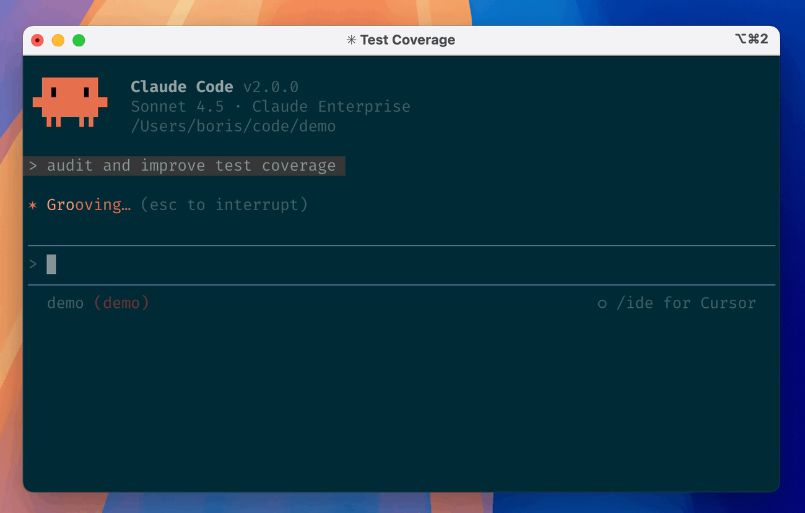
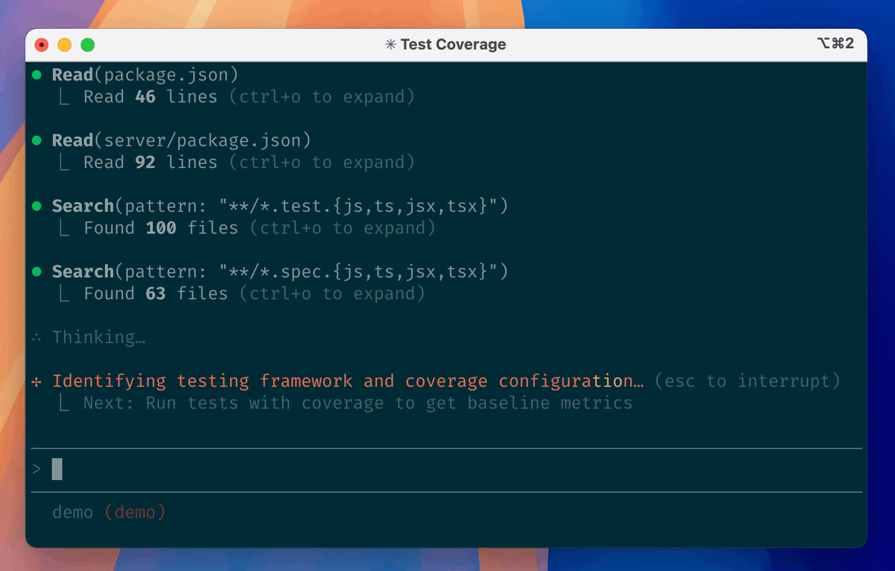
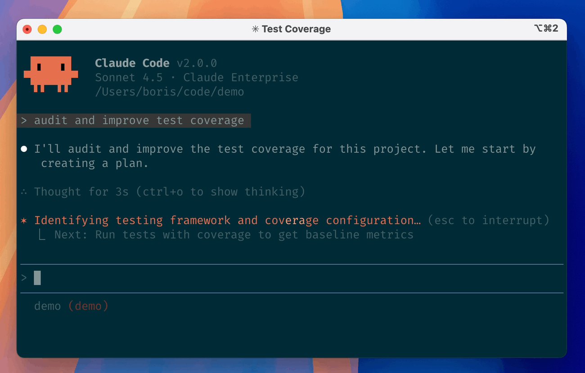
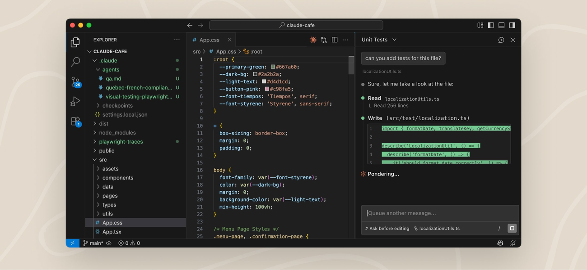

# Claude Code 图文教程：完全不懂编程也能用

> 本教程写给从来没有写过代码、没用过"终端"、也没听说过"AI 编程助手"的人。
> 我们不讲玄乎的原理，而是用大量真实截图和"照着做"的实例，带你把 Anthropic 的 **Claude Code** 从安装到实战完整走一遍。
>
> 📖 **新手请先读 [共用基础篇 basics.md](basics.md)**（终端 / 命令 / 路径 / Git / Token 等概念）。本文默认你已经了解那些基础。

---

## 写在前面

### 这本教程是给谁的？

- 你听说过"AI 能帮忙写代码 / 做网页"，但完全不知道从哪开始。
- 你打开过一些教程，里面写着 `/**`、`npm`、`API Key`，但**没告诉你这些到底是什么意思，更没演示怎么用**。
- 你用的是 **Windows** 电脑（本教程以 Windows 为主，走 WSL）。
- 你有 Claude 账号（Pro / Max 等），想让 AI 帮你真正动手做点东西。

### 读完之后，你能做到

1. 在自己的 Windows 电脑上把 Claude Code 装好并登录。
2. 看懂终端界面，会用它提问、让它改文件、出错时回退。
3. 学会它的"安全气囊"——**计划模式**与**权限**，以及 **`/rewind` 检查点**。
4. 让它帮你从零做出一个**待办事项网页（To-Do）**。

### 阅读约定

图标含义、命令写法等，见 **[共用基础篇 basics.md](basics.md)**。可复制的命令仍放在灰色代码块里：

```bash
claude --version
```

> 💡 **关于截图**：本教程尽量使用网页上可找到的真实截图。凡是找不到合适画面的，会留给你按 [`assets/README.md`](assets/README.md) 的清单自行截图。

---

## 第 1 章　开用之前的基础概念

本章内容已移动到 **[共用基础篇 basics.md](basics.md)**，请先阅读那一篇。读完后，从第 2 章继续。

> 💡 Claude Code 与其它工具的基础完全相通。想对比学习，可另见 [OpenCode 图文教程](opencode.md) 与 [Codex 图文教程](codex.md)。

---

## 第 2 章　安装 Claude Code（Windows 为主）

Windows 用户本教程**推荐用 WSL**（与同系列其它教程保持一致），Claude Code 也支持 Windows 原生安装，稍后也会给出。

### 2.1 Claude Code 和前面几款有什么不同？

| 对比项 | Claude Code（本篇） | OpenCode / Codex |
| --- | --- | --- |
| 出品方 | Anthropic | 社区 / OpenAI |
| 安装 | 原生脚本（**npm 安装已弃用**） | 类似 |
| 登录 | **Claude 订阅账号**（Pro/Max/Team）或 Console / API Key | API Key / ChatGPT 账号 |
| 安全控制 | **权限模式 + 计划模式 + 检查点 `/rewind`** | Plan/Build / 审批+沙箱 |
| 记忆文件 | **CLAUDE.md**（也读 AGENTS.md） | AGENTS.md |
| 自定义命令 | `.claude/commands/` | `.opencode/commands/` / Skills |

一句话：**玩法相通，学会一个，其它的也能快速上手。**

### 2.2 第一步：安装 WSL（与同系列其它教程相同）

1. 打开终端。
2. 输入下面这行，按回车：

```powershell
wsl --install
```

3. 它会自动下载并安装 Ubuntu，过程中可能需要**重启电脑**。

> 
>
> 📷 图（来源：Microsoft Learn WSL 官方文档）—— 在 Windows PowerShell 里输入 `wsl --install` 的真实画面。

4. 重启后，Windows 可能**自动弹出 Ubuntu 窗口**，第一次会让你设置**用户名**和**密码**：

> 
>
> 📷 图（来源：Microsoft Learn WSL 官方文档）—— 会停在 `Enter new UNIX username:` 等你输入用户名。

   - 用户名：随手起，比如 `ming`（小写字母，别用中文）。
   - 密码：**输入时屏幕不显示任何字符**，这是正常的。输完回车，再输一遍确认。

### 2.3 第二步：在 Ubuntu 里安装 Claude Code

打开 Ubuntu 窗口，粘贴下面这行，按回车：

```bash
curl -fsSL https://claude.ai/install.sh | bash
```

> 💡 在 Ubuntu 里粘贴的快捷键通常是 **鼠标右键** 或 `Ctrl + Shift + V`。

装完后验证：

```bash
claude --version
```

显示出版本号就成功了。还可以做一次"体检"：

```bash
claude doctor
```

> 📷 截图（待补充）：`assets/cc-version.png` —— `claude --version` 或 `claude doctor` 的画面。

### 2.4 方法 B：Windows 原生安装（不用 WSL）

Claude Code 支持在 Windows 上原生运行。打开 **PowerShell**：

```powershell
irm https://claude.ai/install.ps1 | iex
```

或用 **WinGet**：

```powershell
winget install Anthropic.ClaudeCode
```

macOS / Linux 也可用 Homebrew：

```bash
brew install --cask claude-code
```

> ⚠️ **npm 安装方式已被官方弃用**，别再照旧教程用 `npm install -g @anthropic-ai/claude-code`。

### 2.5 准备一个练习文件夹

在 Ubuntu 里输入：

```bash
mkdir ~/claude-practice
cd ~/claude-practice
```

> 🧪 **练习 2-1**
>
> **验收标准**：打开 Ubuntu → `claude --version` 看到版本号 → `cd ~/claude-practice` 后提示符里出现 `claude-practice`。

---

## 第 3 章　第一次运行：登录与界面

### 3.1 启动并登录

```bash
cd ~/claude-practice
claude
```

第一次运行会**打开浏览器让你登录**（用你的 Claude 订阅账号，或用 Console / API Key）。登录成功后回到终端。

> 
>
> 📷 图（来源：Claude Code 官方仓库 `demo.gif` 抽帧）—— 真实界面。最上方是版本、模型与所在目录；中间是对话区；底部 `>` 是输入框；再下面是状态栏（显示当前目录/分支等）。

> 💡 WSL2、SSH 或容器里，浏览器有时无法自动跳回，终端会让你**粘贴一段登录码**，照做即可。
>
> 💡 如果你设置了环境变量 `ANTHROPIC_API_KEY`，首次启动会问你是否使用它，确认后就不用浏览器登录。

### 3.2 验证登录

在会话里输入：

```
/status
```

会显示当前账号、模型、目录等信息。想切换账号用 `/login`，退出登录用 `/logout`。

> 📷 截图（待补充）：`assets/cc-login.png` —— 首次启动的浏览器登录/授权画面。

### 3.3 必会快捷键

| 按键 | 作用 |
| --- | --- |
| `Enter` | 发送消息 |
| `\` + `Enter` | 换行（多行输入） |
| `Shift + Tab` | 循环切换**权限/计划模式**（第 6 章） |
| `Esc` | 中断当前回答 |
| `Esc` `Esc` | 回到上一条消息重新编辑（部分版本） |
| `Ctrl + C` | 取消当前操作 |
| `Ctrl + D` | 退出会话 |
| `Ctrl + L` | 清屏 |
| `Ctrl + R` | 搜索历史输入 |
| `Ctrl + O` | 显示/隐藏思考与工具细节 |
| `Ctrl + T` | 显示任务清单（todos） |
| `↑` | 翻出上一条输入 |
| `Ctrl + V` | 粘贴图片 |
| `@` | 引用文件（4.2） |
| `!` | 直接运行命令（4.3） |
| `#` | 快速写入记忆（4.4） |
| `/` | 斜杠命令菜单 |

### 3.4 说第一句话

```
用一句话介绍当前文件夹是做什么的
```

回车，稍等几秒，Claude 就会回复你。🎉

> 🧪 **练习 3-1**
>
> **验收标准**：你能启动 `claude`、完成登录、发出第一句提问并收到回复，用 `/status` 查看状态。

---

## 第 4 章　核心"符号"完全解析（重点）

很多教程只告诉你"用 `@` 可以引用文件"，却不演示**输入之后屏幕到底长什么样**。这一章把 Claude Code 的几种核心交互彻底讲透。

| 符号/操作 | 作用 | 一句话记忆 |
| --- | --- | --- |
| `/` | 斜杠命令 | "执行一个内置动作" |
| `@` | 引用文件 | "把某个文件拿给它看" |
| `!` | 运行 shell 命令 | "在对话里顺手跑一条命令" |
| `#` | 写入记忆 | "让它记住这条偏好" |
| 粘贴图片 | 给 AI 看图 | "把图丢给它参考" |

### 4.1 `/` 斜杠命令

**它是什么**：输入 `/` 会弹出内置动作列表，选一个就执行。

**怎么用**：输入 `/`，弹出列表，用方向键选或继续打字筛选。

> 📷 截图（待补充）：`assets/cc-commands.png` —— 输入 `/` 后弹出的命令列表。

**常用命令**（完整清单见附录 A）：

| 命令 | 作用 |
| --- | --- |
| `/init` | 生成 `CLAUDE.md` 项目说明书（第 8 章） |
| `/memory` | 编辑记忆文件（第 8 章） |
| `/model` | 切换模型（第 12 章） |
| `/plan` | 进入计划模式，先出方案（第 6 章） |
| `/permissions` | 查看/修改权限（第 6 章） |
| `/rewind` | 回退对话与代码（第 7 章） |
| `/compact` | 压缩对话、释放上下文 |
| `/clear` | 清空对话重新开始 |
| `/resume` | 恢复历史会话 |
| `/config` | 打开设置 |
| `/cost` | 查看用量花费 |
| `/status` | 查看账号与系统状态 |
| `/doctor` | 检查安装是否健康 |
| `/help` | 帮助 |

**完整演示**：拿 `/help` 演示一遍。

- **第 1 步｜它是什么**：列出所有可用命令及说明。
- **第 2 步｜你要输入**：
  ```
  /help
  ```
- **第 3 步｜屏幕上会出现**：帮助列表。
- **第 4 步｜用途**：不记得命令时随时查。

### 4.2 `@` 引用文件

**它是什么**：`@` 指名引用项目里的文件，让它直接读内容，而不用自己翻找。

**完整演示**：

- **第 2 步｜你要输入**（输入 `@` 后继续打文件名，选中）：
  ```
  请解释 @app.js 这个文件是做什么的
  ```
- **第 3 步**：Claude 读取该文件后用中文讲解。
- **第 4 步**：你不用自己看懂代码，也能知道每个文件在干嘛。

### 4.3 `!` 运行 shell 命令

**它是什么**：消息以 `!` 开头时，直接把它当**终端命令**执行，结果进入对话。

**完整演示**：

- **第 2 步｜你要输入**：
  ```
  !git status
  ```
- **第 3 步**：命令输出被加入对话。
- **第 4 步**：你可以在对话里顺手做检查，再让 Claude 解释结果。

> ⚠️ `!` 会真的在你电脑上执行命令，不确定后果的命令别乱敲。

### 4.4 `#` 快速写入记忆

**它是什么**：以 `#` 开头的消息，会作为一条**记忆**被写进 `CLAUDE.md`（第 8 章），以后每次都会生效。

**完整演示**：

- **第 2 步｜你要输入**：
  ```
  # 这个项目的注释一律用中文
  ```
- **第 3 步**：Claude 把这条规则记进记忆文件，之后写代码会遵守。
- **第 4 步**：不用每次重复交代偏好。

### 4.5 粘贴图片

把截图/设计图**直接粘贴**（`Ctrl + V`）进输入框，Claude 就能"看图"。

> 📷 截图（待补充）：`assets/cc-image.png` —— 粘贴图片后消息里出现图片附件。

### 4.6 Claude 的"工具调用"长什么样

Claude Code 干活时，会在对话里显示它调用了哪些工具（读文件、搜索、运行命令等），你可以按 `Ctrl + O` 展开细节。

> 
>
> 📷 图（来源：Claude Code 官方 `demo.gif` 抽帧）—— 可以看到它一连串的 `Read(...)` / `Search(...)`，以及下方"正在做什么"的实时进度。

它还会显示"思考了多久"等过程信息，按 `Ctrl + O` 可以展开查看：

> 
>
> 📷 图（来源：Claude Code 官方 `demo.gif` 抽帧）—— `Thought for 3s (ctrl+o to show thinking)`。

> 🧪 **练习 4-1**
>
> 依次观察：① 输入 `/` 看命令列表；② 用 `@` 引用一个文件并提问；③ 输入 `!ls` 看命令结果进入对话；④ 用 `#` 写一条记忆。

---

## 第 5 章　像聊天一样让它干活

Claude Code 最常用的方式，就是**用大白话描述你想要什么**。

### 5.1 场景一：让它解释项目

```
请用简单的话，总结一下这个项目是做什么的，每个文件大概负责什么。
```

### 5.2 场景二：改一处东西

```
请把 index.html 里网页的标题改成"小明的工作台"。
```

它会打开文件、修改，并显示改动（绿色新增、红色删除）。

### 5.3 场景三：加一个新功能

```
请给每一条待办事项加一个"删除"按钮，点击后能从列表里移除。
```

### 5.4 怎么把需求说清楚？（新手最关键的一课）

把 AI 当成**刚入职的新同事**：你不说清楚，他就会猜。

| 坏说法（太模糊） | 好说法（清楚具体） |
| --- | --- |
| 帮我弄好看点 | 把主色调改成蓝色，标题居中，按钮改成圆角 |
| 这个报错了 | 我运行时报错"xxx"，请看 app.js 并解释原因 |
| 加个功能 | 加一个"清空全部待办"的按钮，放在列表下方 |

**万能公式**：

```
我要【做什么】，文件在【哪些文件】，希望【达到什么效果】，要注意【什么限制】。
```

### 5.5 小技巧：先让它解释再动手

不确定它会不会乱来时，先说：

```
先不要改任何文件，只告诉我你打算怎么做。
```

确认没问题后，再说"好，开始改吧"。

> 🧪 **练习 5-1**
>
> **验收标准**：你能用"万能公式"写出一个需求，让 Claude 成功修改一个文件。

---

## 第 6 章　安全气囊：计划模式与权限

这是 Claude Code 非常重要的设计。理解它，你就不怕它乱改文件了。

### 6.1 计划模式（Plan Mode）

**它是什么**：在这个模式下，Claude **只做调研、只给方案，不改任何文件**。

**怎么进入**：

- 按 `Shift + Tab` **循环切换模式**，切到 **Plan mode**；或直接输入 `/plan`。
- 也可以启动时指定：`claude --permission-mode plan`。

**完整演示**：

- **第 1 步｜目标**：给待办应用加"优先级"功能。
- **第 2 步｜操作**：切到 **Plan mode**，输入：
  ```
  我想给每条待办加"高/中/低"优先级标签，用不同颜色显示。请先给方案。
  ```
- **第 3 步｜屏幕上会出现**：一份实现计划，**不会改文件**。

  > 📷 截图（待补充）：`assets/cc-plan.png` —— 计划模式只给方案。

- **第 4 步｜确认后**：切回普通模式，说"开始实现"。

> 
>
> 📷 图（官方 `demo.gif` 抽帧，示意界面）。模式指示会出现在界面里。

### 6.2 权限模式一览

`Shift + Tab` 循环的几种模式（不同版本名称略有差异，以界面为准）：

| 模式 | 含义 |
| --- | --- |
| **Default（普通）** | 每次改文件 / 跑命令都先问你 |
| **Auto-Accept Edits（自动接受编辑）** | 改文件不再逐个确认（更省事，也更需要你盯住） |
| **Plan mode（计划）** | 只出方案、不改文件 |
| **Bypass Permissions（绕过）** | 什么都不问，**风险最高，慎用** |

### 6.3 精细权限：`settings.json`

除了模式，还能在设置里精确规定"哪些操作允许/禁止/询问"。相关字段：`permissions.allow`、`permissions.deny`、`permissions.ask`。

- 查看/修改：会话里输入 `/permissions`。
- 启动时限定工具：`--allowedTools`、`--disallowedTools`。

> 📷 截图（待补充）：`assets/cc-permissions.png` —— `/permissions` 或权限确认弹窗。

> ⚠️ 新手建议：保持 **Default** 模式，看到询问**看懂再同意**。

> 🧪 **练习 6-1**
>
> **验收标准**：你能用 `Shift+Tab` 切到计划模式，让 Claude 给出方案（且真的没改文件），再切回来让它执行。

---

## 第 7 章　改错了怎么办：`/rewind` 检查点 + Git

Claude Code 有个很贴心的"后悔药"：**检查点**。它会在每次改动前自动记录状态，你可以随时回退。

### 7.1 `/rewind`：一键回退

**它是什么**：把对话和代码**回退到之前的某个检查点**。

**完整演示**：

- **第 1 步｜场景**：你让它改样式，结果改得很丑。
- **第 2 步｜你要输入**：
  ```
  /rewind
  ```
- **第 3 步｜屏幕上会出现**：一个可选择的检查点列表（"回到刚才"等）。
- **第 4 步｜用途**：选一个时间点，对话与文件一起回退，然后换个说法重来。

> 📷 截图（待补充）：`assets/cc-rewind.png` —— `/rewind` 的检查点列表。

> ⚠️ 检查点好用，但**不是 Git 的替代品**。重要节点仍建议手动 Git 提交。

### 7.2 用 Git 当更稳的"后悔药"

最稳妥的做法是：**让 Claude 大改之前先提交一次**。

```bash
cd ~/claude-practice
git init
git add .
git commit -m "初始版本"
```

改坏了想全部还原：

```bash
git checkout -- .
```

> ⚠️ `git checkout -- .` 会丢弃**当前所有未保存改动**，用前先确认。

> 🧪 **练习 7-1**
>
> **验收标准**：让 Claude 改一个文件 → `/rewind` 回到改之前 → 确认文件恢复。

---

## 第 8 章　记住你的项目：CLAUDE.md 与记忆

每次开新会话都重新解释一遍规则太累。**记忆文件**就是解决这个问题的。

### 8.1 什么是 CLAUDE.md？

它是一份放在项目里的**说明书**，告诉 Claude：项目做什么、怎么运行测试、有哪些规范。每次启动都会自动读取——**就像给新同事留的交接文档**。

> 💡 Claude Code 也**兼容 `AGENTS.md`**（OpenCode、Codex 用的就是它）。已有 `AGENTS.md` 的项目不用重复写。

### 8.2 用 `/init` 自动生成

```
/init
```

它会扫描项目并生成一个 `CLAUDE.md` 起始文件。

### 8.3 手动编辑与 `/memory`

- 用记事本/编辑器直接改 `CLAUDE.md`。
- 或在会话里输入 `/memory`，让它打开记忆文件来编辑。
- 平时用 `#` 开头的一句话也能快速追加一条（第 4.4 节）。

例子：

```markdown
# 我的待办项目

## 项目说明
这是一个纯前端的待办事项网页，用 HTML + CSS + JavaScript 写成。

## 如何运行
直接用浏览器打开 index.html 即可。

## 代码约定
- 变量名用英文，注释用中文。
- 颜色统一用 CSS 变量管理。
```

### 8.4 记忆放在哪：项目级与全局

- **项目级**：项目里的 `CLAUDE.md`（或 `.claude/` 目录下相关文件），**只对这个项目生效**。
- **全局**：`~/.claude/CLAUDE.md`，**对你所有项目生效**，适合个人偏好。
- **按类型分规则**：把针对性规则放进 `.claude/rules/`，可按文件类型生效。
- **自动记忆**：Claude 也会根据你的纠正，自动记下一些偏好。

> ⚠️ 记忆是"上下文建议"，不是强制。要**强制禁止**某类操作，用权限设置（第 6 章）或 Hooks（第 14 章）。

> 🧪 **练习 8-1**
>
> **验收标准**：你让 Claude 生成一份 `CLAUDE.md`，并加一条"注释用中文"的规则，重启后确认它遵守。

---

## 第 9 章　自定义斜杠命令：把重复劳动变成 `/一键`

如果你总在做同一套操作，可以把它做成自己的斜杠命令。

### 9.1 命令文件放哪里？

- **项目级**（团队共享）：`.claude/commands/`，例如 `.claude/commands/optimize.md` → `/optimize`。
- **个人级**（所有项目）：`~/.claude/commands/`。
- **子目录做命名空间**：`.claude/commands/frontend/component.md` → `/frontend:component`。

### 9.2 完整演示：做一个 `/optimize`

**第 1 步｜创建文件** `.claude/commands/optimize.md`：

```markdown
---
description: 分析性能问题并给出优化建议
---

分析当前代码的性能问题，列出瓶颈并给出优化建议。
```

**第 2 步｜使用**：在 Claude Code 里输入：

```
/optimize
```

**第 3 步｜屏幕上会出现**：Claude 按你预设的提示去执行。

### 9.3 让命令接收参数

- `$ARGUMENTS`：所有参数；`$1`、`$2`…：第几个参数。

例如 `.claude/commands/component.md`：

```markdown
---
description: 创建一个新组件
argument-hint: 组件名
---

请创建一个名为 $ARGUMENTS 的新组件，使用 TypeScript。
```

运行 `/component Button`，`$ARGUMENTS` 就变成 `Button`。

### 9.4 两个实用写法

- **引用文件**：写 `@路径`，例如 `Review @src/utils/helpers.js`。
- **注入命令输出**：写 `` !`命令` ``，例如 `` !`git log --oneline -5` ``。

> 💡 命令的 frontmatter 还能限定 `allowed-tools`、`model`、`argument-hint` 等。

> 📷 截图（待补充）：`assets/cc-custom-command.png` —— 触发自定义命令 `/optimize` 的样子。

> 🧪 **练习 9-1**
>
> **验收标准**：你创建一条自定义命令，输入 `/命令名 参数` 能触发，且参数替换生效。

---

## 第 10 章　子代理 Subagents

**子代理**是"专门干某类活"的独立助手：它在**自己的上下文**里工作，干完只把结论返回主对话，从而**不让主对话被大量日志/搜索结果淹没**。

### 10.1 手动使用与查看

```
/agents
```

可以查看、创建、管理子代理。Claude 遇到匹配的任务时也会**自动**委派给子代理。

### 10.2 创建你自己的子代理

在 `.claude/agents/` 放一个 Markdown 文件，例如 `.claude/agents/reviewer.md`：

```markdown
---
name: reviewer
description: 审查代码质量，只提建议不修改
tools: Read, Grep, Glob
---

你是代码审查员。重点检查代码规范、潜在 bug、性能与安全隐患。
只给建议，不要直接修改文件。
```

保存后就能在任务里让 Claude 使用这个 `reviewer` 子代理。

> 📷 截图（待补充）：`assets/cc-subagent.png` —— `/agents` 或子代理工作的画面。

> ⚠️ 子代理会单独消耗额度（计入同样的用量限制）。

> 🧪 **练习 10-1**
>
> **验收标准**：你创建一个只读的审查子代理，并让 Claude 用它给一段代码提建议。

---

## 第 11 章　常用命令与工作流

| 操作 | 作用 |
| --- | --- |
| `/clear` | 清空对话，重新开始（别名 `/reset`、`/new`） |
| `/compact` | 压缩对话、释放上下文（可带聚焦说明） |
| `/resume` | 恢复历史会话 |
| `/rename` | 给当前会话改名 |
| `/export` | 导出对话 |
| `/copy` | 复制最近回复 |
| `/context` | 查看上下文占用情况 |
| `/cost` | 查看用量与花费 |
| `/usage` | 查看账号额度用量 |
| `/todos` | 查看当前任务清单 |
| `/tasks` | 查看后台任务 |
| `/status` | 查看账号与系统状态 |
| `/btw` | 问一个不打乱主线的"顺便问一下" |
| `/add-dir` | 额外授权一个目录 |

命令行也可以继续上次会话：

```bash
claude --continue     # 继续最近一次
claude --resume       # 选择要恢复的会话
```

> 💡 上下文快满时，用 `/compact` 压缩，或 `/clear` 重开。

> 🧪 **练习 11-1**
>
> **验收标准**：你开一个新会话、`/rename` 命名、退出后用 `claude --resume` 找回。

---

## 第 12 章　模型与配置

### 12.1 `/model`：切换模型

```
/model
```

可在 Sonnet / Opus / Haiku 等之间切换（也可指定完整模型名）。命令行：`claude --model sonnet`。

### 12.2 `/config`：打开设置

```
/config
```

会打开设置界面，或引导你编辑配置文件。

### 12.3 配置文件与优先级

Claude Code 的配置文件是 `settings.json`，从低到高依次是：

| 级别 | 文件 | 谁在用 |
| --- | --- | --- |
| 5（最低） | `~/.claude/settings.json` | 你的全局设置 |
| 4 | `.claude/settings.json` | 项目共享（可提交 Git） |
| 3 | `.claude/settings.local.json` | 你的项目本地设置（不提交） |
| 2 | 命令行 `claude --settings ...` | 本次会话 |
| 1（最高） | 企业托管设置 | 组织统一管理 |

**高层级覆盖低层级**。

一个最小例子（`.claude/settings.json`）：

```json
{
  "permissions": {
    "allow": ["Bash(git status:*)"],
    "deny": ["Bash(rm:*)"]
  }
}
```

读作：允许运行 `git status`，禁止运行 `rm`。

### 12.4 外观与手感

- `/theme`：配色主题。
- `/vim`：Vim 键位。
- `/statusline`：自定义状态栏。
- 输出风格（output style）可在配置里切换。

> 📷 截图（待补充）：`assets/cc-config.png` —— `/config` 或 `settings.json`。

> 🧪 **练习 12-1**
>
> **验收标准**：你用 `/model` 切换一次模型，用 `/config` 或编辑 `settings.json` 改一个设置并生效。

---

## 第 13 章　MCP：接入外部工具（进阶）

MCP（Model Context Protocol）是一种"让 AI 连接外部工具"的标准协议。接入后，Claude 能用上你已有的服务（数据库、文档、第三方应用等）。

- 命令行管理：
  ```bash
  claude mcp add <名字> -- <启动命令>   # 添加一个 MCP 服务器
  claude mcp list                       # 查看已配置的
  ```
- 也支持在项目里放 `.mcp.json`（可提交 Git，团队共享）。
- 会话里用 `/mcp` 管理连接和登录。

> 💡 MCP 服务器有作用范围（本地 / 项目 / 用户），别把带密钥的配置提交到公开仓库。

> 📷 截图（待补充）：`assets/cc-mcp.png` —— `/mcp` 列表。

> ⚠️ 接入外部工具意味着数据可能发往第三方，只接入你信任的来源。

---

## 第 14 章　Hooks：自动化钩子（进阶）

Hooks（钩子）让你在 Claude Code 的生命周期节点上"自动做一件事"（跑脚本、发通知等）。

- 常见事件：`PreToolUse`（用工具前）、`PostToolUse`（用工具后）、`UserPromptSubmit`（你提交提示词后）、`Stop`（回答结束时）、`SessionStart`（会话开始）等。
- 配置写在 `settings.json` 的 `hooks` 字段里。
- 会话里输入 `/hooks` 可以交互式查看和管理。

典型用途：每次改完代码后自动跑格式化/测试；需要时发桌面通知。

> 📷 截图（待补充）：`assets/cc-hooks.png` —— `/hooks` 配置界面。

> ⚠️ 钩子会执行真实脚本，**只配置你信任的命令**。

> 🧪 **练习 14-1**
>
> **验收标准**：你说得出至少一个钩子事件和它能做什么。

---

## 第 15 章　代码审查与图片

### 15.1 `/review`：请求代码审查

在会话里输入：

```
/review
```

让 Claude 对当前改动做一次审查。相关命令还有 `/pr_comments`（查看 Pull Request 评论）。取决于你的配置，还可能带有安全审查等专用技能。

> 📷 截图（待补充）：`assets/cc-review.png` —— `/review` 的审查结果。

### 15.2 图片输入

- 直接把图片**粘贴**（`Ctrl + V`）进输入框，或把文件路径告诉它。
- 用途：给它看报错截图、设计稿、手绘草图，然后让它照着做。

> 🧪 **练习 15-1**
>
> **验收标准**：你让 Claude 审查一次改动，并粘贴一张图片让它描述。

---

## 第 16 章　无界面自动化：`claude -p`（进阶）

前面都是交互模式。`-p`（print）模式可以**发一条指令就让它干完**，适合脚本和 CI。

### 16.1 基本用法

```bash
claude -p "用中文总结这个仓库的结构"
```

- 用 `--output-format` 控制输出：`text`（默认）、`json`、`stream-json`。
- 用 `--max-turns` 限制轮数，`--max-budget-usd` 限制花费。
- 可以把内容管道进来：

```bash
cat app.js | claude -p "review this code"
```

### 16.2 自动化里控制权限

在无人值守场景，通常要预先声明允许哪些工具，避免卡在询问上：

```bash
claude -p "运行测试并总结失败项" --allowedTools "Bash(npm test)" "Read"
```

> ⚠️ 无人值守时**遵循最小权限**：只放开必需的工具。不要在生产环境随意使用"绕过权限"。

> 📷 截图（待补充）：`assets/cc-headless.png` —— `claude -p` 的输出。

> 🧪 **练习 16-1**
>
> **验收标准**：你用 `claude -p` 让 Claude 总结当前文件夹，并把结果输出到文件。

---

## 第 17 章　更多形态：桌面 App、IDE、网页与集成（进阶）

Claude Code 不只在终端里，还有这些形态：

| 形态 | 怎么用 | 说明 |
| --- | --- | --- |
| 桌面 App | 官网下载 | 图形界面，不用记命令 |
| VS Code / JetBrains 扩展 | 在编辑器里安装，会话里 `/ide` 连接 | 看改动、就地审查 |
| 网页版 | <https://claude.ai/code> | 浏览器里用，可把任务交到云端 |
| Slack | 官方集成 | 在 Slack 里 @ 它 |
| GitHub Actions / GitLab | 官方集成 | 在 CI/CD 里自动跑 |

> 
>
> 📷 图（来源：Claude Code 官方文档）—— 在 VS Code 里用扩展查看对话、改动与文件树（左侧还能看到 `.claude/agents`、`settings.json` 等）。

> 💡 新手先把终端玩熟，这些作为"知道有、以后用"即可。

---

## 第 18 章　出问题别慌（排错指南）

### 18.1 `claude: command not found`（找不到命令）

1. 安装是否成功？重跑安装命令。
2. 是不是在**错误的窗口**里敲？WSL 用户要在 **Ubuntu** 窗口里输入。
3. 重开一个终端再试。

### 18.2 登录失败 / 浏览器打不开

- WSL2 / SSH / 容器里，浏览器常无法自动跳回：终端会让你**粘贴登录码**，照做。
- 按 `c` 可以把登录链接复制到剪贴板，手动在浏览器打开。
- 没有 claude.ai 账号，可用 Console 或 API Key（环境变量 `ANTHROPIC_API_KEY`）。

### 18.3 搜索/找文件失败

Claude Code 用 `ripgrep` 做搜索；若报相关错误，按官方"搜索排错"文档处理（多数安装会自带）。

### 18.4 卡住 / 想中断

- 按 `Esc` 中断当前回答；按 `Ctrl + C` 取消操作。
- 想退出：`/exit` 或 `Ctrl + D`。

### 18.5 网络问题（需要使用代理时）

下载或连接失败时，可先设置代理再执行：

```bash
export HTTPS_PROXY=http://127.0.0.1:7890
export HTTP_PROXY=http://127.0.0.1:7890
```

> 💡 代理的具体配置方法，请参考你所用代理软件的说明。

### 18.6 体检、更新、卸载

```bash
claude doctor     # 生成健康检查报告，排错很有用
claude update     # 更新到最新版
```

卸载方式取决于安装方式（原生脚本 / winget / Homebrew），以官方文档为准。

### 18.7 去哪里求助

- 官方文档：<https://code.claude.com/docs>
- GitHub 仓库 / 提 Issue：<https://github.com/anthropics/claude-code>
- 会话里用 `/bug` 直接反馈。

提问时附上：你输入的命令、完整报错、系统（Windows/WSL）。这样别人才能帮你。

> 🧪 **练习 18-1**
>
> **验收标准**：你知道卡住时按 `Esc`/`Ctrl+C`，并用 `claude doctor` 生成过报告。

---

## 第 19 章　综合实战：从空文件夹做出"待办事项网页"

把前面学的东西串起来，做一个能用的待办事项（To-Do）网页。

### 19.1 目标效果

一个网页，可以：输入待办并添加、看到列表、勾选完成、删除单条、清空全部，刷新后数据还在。

> 
>
> 📷 截图（待补充）：`assets/cc-final-todo.png` —— 做出来的待办网页。

### 19.2 步骤一：准备项目并初始化 Git

在 Ubuntu 终端里：

```bash
mkdir ~/claude-todo
cd ~/claude-todo
git init
```

> 对应第 7 章——任务前后各存一个版本，最稳妥。

### 19.3 步骤二：启动并写说明书

```bash
claude
```

进入后先建立项目说明书：

```
/init
```

如果项目是空的，Claude 可能问你项目做什么，就回答：

```
这是一个纯前端的待办事项网页，用 HTML + CSS + JavaScript 写，双击 index.html 即可运行。
```

### 19.4 步骤三：先进入计划模式出方案

按 `Shift + Tab` 切到 **Plan mode**，输入：

```
我要做一个待办事项网页。要求：
1. 一个输入框和一个"添加"按钮；
2. 列表每条可勾选完成、可删除；
3. 有一个"清空全部"按钮；
4. 数据存在浏览器本地，刷新不丢；
5. 界面简洁，主色调用蓝色。
请先给方案，不要改文件。
```

读一读方案，满意就继续；想调整就补充，比如"删除前加确认提示"。

### 19.5 步骤四：动手实现

切回普通模式，输入：

```
方案可以，开始实现。
```

它会创建文件（通常是 `index.html`、`style.css`、`app.js`）。

> 
>
> 📷 截图（待补充）：`assets/cc-final-todo-code.png` —— 生成的项目文件列表。

### 19.6 步骤五：在浏览器里查看

先确认文件都在：

```
!ls -la
```

再在文件管理器里找到 `~/claude-todo`，**双击 `index.html`** 就能看到网页。

> 💡 `~/` 在 Windows 文件管理器里通常是 `\\wsl$\Ubuntu\home\你的用户名\`；也可在 Ubuntu 里输入 `explorer.exe .` 打开当前目录。

### 19.7 步骤六：故意改错，再用 `/rewind` 救回来

```
请把主色调改成刺眼的荧光绿。
```

觉得丑就回退：

```
/rewind
```

选回到改之前，确认颜色恢复。想更保险，可先 `git add . && git commit -m "存档"`。

### 19.8 步骤七：加个小功能并保存

用计划模式讨论"给待办加高/中/低优先级"，实现后：

```bash
git add .
git commit -m "完成待办网页 v1"
```

### 19.9 回顾：你用到了哪些知识？

| 章节 | 用到的功能 |
| --- | --- |
| 第 3 章 | 登录、界面 |
| 第 4 章 | `/`、`@`、`!`、`#` |
| 第 6 章 | 计划模式、权限 |
| 第 7 章 | `/rewind`、Git |
| 第 8 章 | `/init`、CLAUDE.md |

> 🧪 **终极练习 19-1**
>
> 不看教程，独立从空文件夹再做一个"个人记账"或"便签"网页，走完 计划模式 → 实现 → `/rewind` → Git 提交 的完整流程。

---

## 附录 A　斜杠命令速查

| 命令 | 作用 |
| --- | --- |
| `/init` | 生成 `CLAUDE.md` |
| `/memory` | 编辑记忆文件 |
| `/model` | 切换模型 |
| `/plan` | 进入计划模式 |
| `/permissions` | 查看/修改权限 |
| `/rewind` | 回退对话与代码（检查点） |
| `/compact` | 压缩对话 |
| `/clear`（`/reset`、`/new`） | 清空对话 |
| `/resume` | 恢复会话 |
| `/rename` | 重命名会话 |
| `/export` | 导出对话 |
| `/copy` | 复制最近回复 |
| `/context` | 查看上下文占用 |
| `/cost` | 查看花费 |
| `/usage` | 查看额度用量 |
| `/todos` | 查看任务清单 |
| `/tasks` | 查看后台任务 |
| `/agents` | 管理子代理 |
| `/hooks` | 管理钩子 |
| `/mcp` | 管理 MCP 服务器 |
| `/config` | 打开设置 |
| `/theme` | 切换主题 |
| `/vim` | Vim 键位 |
| `/statusline` | 自定义状态栏 |
| `/add-dir` | 额外授权目录 |
| `/review` | 请求代码审查 |
| `/pr_comments` | 查看 PR 评论 |
| `/ide` | 连接 IDE |
| `/status` | 账号与系统状态 |
| `/doctor` | 健康检查 |
| `/login` / `/logout` | 登录 / 退出登录 |
| `/help` | 帮助 |
| `/bug` | 反馈问题 |
| `/exit` | 退出 |

> 💡 命令会随版本变化，**以会话里输入 `/` 弹出的列表和 `/help` 为准**。

## 附录 B　CLI flags 速查

| Flag | 作用 |
| --- | --- |
| `claude` | 启动交互会话 |
| `claude "提示词"` | 带初始提示启动 |
| `claude -p "提示词"`（`--print`） | 非交互，打印结果 |
| `claude -c`（`--continue`） | 继续最近一次会话 |
| `claude -r`（`--resume`） | 恢复指定会话 |
| `--model <名字>` | 指定模型（`sonnet` / `opus` / `haiku` 等） |
| `--permission-mode <模式>` | 起始权限模式（如 `plan`） |
| `--allowedTools` / `--disallowedTools` | 允许 / 禁止的工具 |
| `--add-dir <目录>` | 额外工作目录 |
| `--output-format <格式>` | `text` / `json` / `stream-json`（print 模式） |
| `--max-turns <n>` | 限制轮数（print 模式） |
| `--max-budget-usd <金额>` | 限制花费（print 模式） |
| `--verbose` | 详细日志 |
| `claude update` | 更新 |
| `claude doctor` | 健康检查 |
| `claude mcp ...` | 管理 MCP |
| `claude --version` / `--help` | 版本 / 帮助 |

## 附录 C　快捷键速查

| 按键 | 作用 |
| --- | --- |
| `Enter` | 发送 |
| `\` + `Enter` | 换行 |
| `Shift + Tab` | 循环权限/计划模式 |
| `Esc` | 中断回答 |
| `Ctrl + C` | 取消操作 |
| `Ctrl + D` | 退出 |
| `Ctrl + L` | 清屏 |
| `Ctrl + R` | 搜索历史 |
| `Ctrl + O` | 显示/隐藏细节 |
| `Ctrl + T` | 任务清单 |
| `↑` | 上一条输入 |
| `Ctrl + V` | 粘贴图片 |
| `@` | 引用文件 |
| `!` | 运行命令 |
| `#` | 写入记忆 |
| `/` | 命令菜单 |

## 附录 D　术语表与官方链接

### 术语表（白话版）

| 术语 | 白话解释 |
| --- | --- |
| 终端 / Terminal | 打字给电脑下命令的窗口 |
| Claude Code | Anthropic 出的终端 AI 编程助手 |
| 斜杠命令 | 输入 `/` 触发的内置动作 |
| 计划模式 / Plan Mode | 只出方案、不改文件的模式 |
| 权限模式 | 决定哪些操作要经过你同意 |
| 检查点 / Checkpoint | 自动存档点，可用 `/rewind` 回退 |
| CLAUDE.md | 给 Claude 看的项目说明书（也认 AGENTS.md） |
| `.claude/commands/` | 自定义斜杠命令存放处 |
| 子代理 / Subagent | 独立上下文的专门助手 |
| Hooks | 生命周期自动钩子 |
| MCP | 让 AI 连接外部工具的协议 |
| 无界面模式 | `claude -p`，用于脚本/CI |
| token | AI 计费与上下文容量单位 |
| WSL | Windows 里的 Linux 子系统 |

### 官方链接

- 官方文档：<https://code.claude.com/docs>
- GitHub 仓库：<https://github.com/anthropics/claude-code>
- 网页版：<https://claude.ai/code>
- 本系列：[共用基础篇](basics.md) · [OpenCode 图文教程](opencode.md) · [Codex 图文教程](codex.md)

---

## 结语

你从"完全不懂终端"走到了"能用 Claude Code 做网页、看改动、回退、还能安全地控制权限"。这已经是了不起的一步。

接下来最有效的进阶方式，就是**不断把手里的小事交给它做**：整理文件、写个小工具、改改网页。做得越多，你就越清楚怎么把需求说清楚、什么时候该用计划模式、什么时候该 `/rewind`。

祝你玩得开心。🚀


