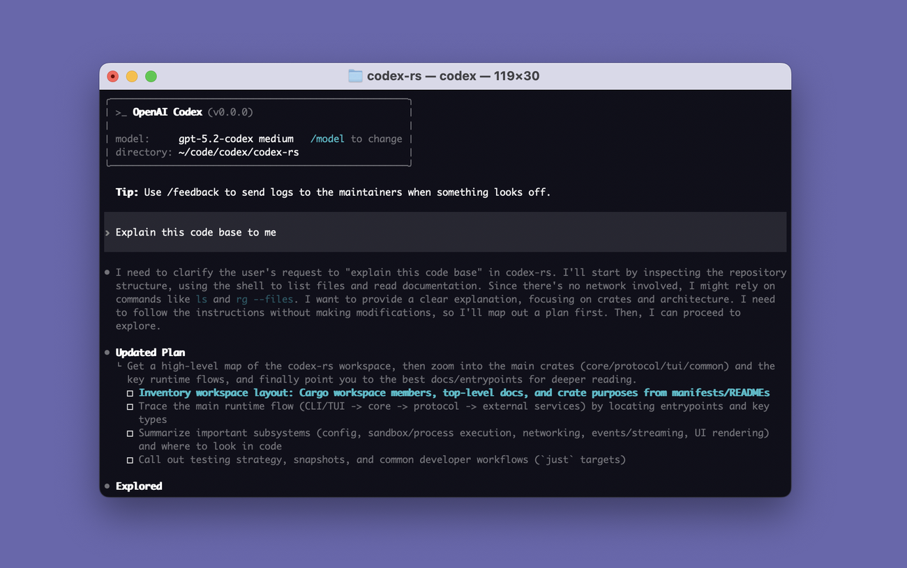
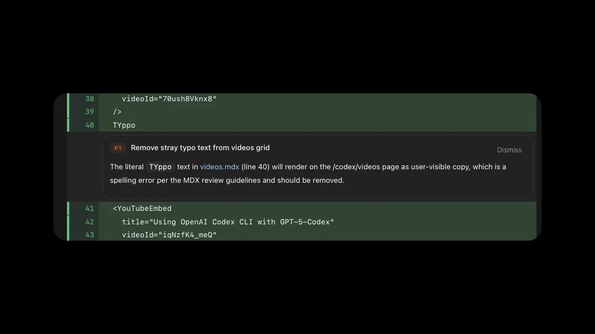
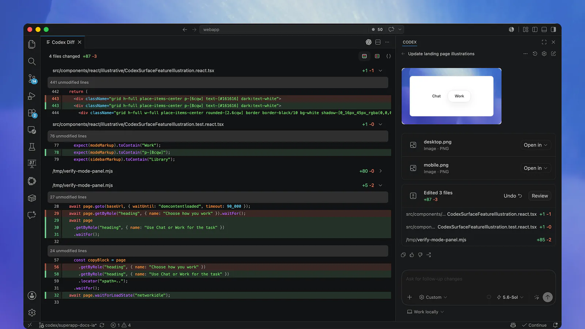

# Codex 图文教程：完全不懂编程也能用

> 本教程写给从来没有写过代码、没用过"终端"、也没听说过"AI 编程助手"的人。
> 我们不讲玄乎的原理，而是用大量真实截图和"照着做"的实例，带你把 OpenAI 的 **Codex 命令行版（Codex CLI）** 从安装到实战完整走一遍。
>
> 📖 **新手请先读 [共用基础篇 basics.md](basics.md)**（终端 / 命令 / 路径 / Git / Token 等概念）。本文默认你已经了解那些基础。

---

## 写在前面

### 这本教程是给谁的？

- 你听说过"AI 能帮忙写代码 / 做网页"，但完全不知道从哪开始。
- 你打开过一些教程，里面写着 `/**`、`npm`、`API Key`，但**没告诉你这些到底是什么意思，更没演示怎么用**。
- 你用的是 **Windows** 电脑（本教程以 Windows 为主）。
- 你有 ChatGPT 账号，想让 AI 帮你真正动手做点东西。

### 读完之后，你能做到

1. 在自己的 Windows 电脑上把 Codex 装好并登录。
2. 看懂终端界面，会用它提问、让它改文件、出错时查看改动并回退。
3. 学会 Codex 的招牌功能**代码审查 `/review`**，以及安全模式 `/plan` 和 `/permissions`。
4. 让它帮你从零做出一个**待办事项网页（To-Do）**。

### 阅读约定

图标含义、命令写法等，见 **[共用基础篇 basics.md](basics.md)**。凡是你能照着敲的命令，都会放在灰色代码块里：

```bash
codex --version
```

**把代码块内容原样敲进终端，按回车即可。**

> 💡 **关于截图**：本教程尽量使用网页上可找到的真实截图。凡是找不到合适画面的，会留给你按 [`assets/README.md`](assets/README.md) 的清单自行截图。

---

## 第 1 章　开用之前的基础概念

本章内容已移动到 **[共用基础篇 basics.md](basics.md)**，请先阅读那一篇。读完后，从第 2 章继续。

> 💡 Codex 与另一款工具 OpenCode 的基础完全相通。想对比学习，可另见 [OpenCode 图文教程](opencode.md)。

---

## 第 2 章　安装 Codex（Windows 为主）

这一章把 Codex 装到你电脑上。Windows 用户本教程**推荐用 WSL**（与 OpenCode 篇保持一致，环境最省心），Codex 也支持 Windows 原生安装，稍后也会给出。

### 2.1 Codex 和 OpenCode 有什么不同？

先花一分钟了解你要学的这款工具：

| 对比项 | Codex（本篇） | OpenCode（另一篇） |
| --- | --- | --- |
| 出品方 | OpenAI | 开源社区 |
| 登录方式 | **可直接用 ChatGPT 账号登录**（也可用 API Key） | 主要用 API Key |
| 安全控制 | **审批模式 + 沙箱**，还有 `/plan` 计划模式 | Plan / Build 两模式 |
| 招牌功能 | **`/review` 代码审查**、`/diff` | `/init`、分享 |
| 配置文件 | `~/.codex/config.toml` | `opencode.json` |
| 自定义命令 | **技能（Skills）**，用 `$` 引用 | 自定义 `/命令` |

一句话：**两者玩法几乎一样，学会一个，另一个也就会了。**

### 2.2 第一步：安装 WSL（与 OpenCode 篇相同）

1. 打开终端（见基础篇）。
2. 输入下面这行，按回车：

```powershell
wsl --install
```

3. 它会自动下载并安装 Ubuntu。过程中可能需要你**重启电脑**。

> 
>
> 📷 图（来源：Microsoft Learn WSL 官方文档）—— 在 Windows PowerShell 里输入 `wsl --install` 的真实画面。

4. 重启后，Windows 可能会**自动弹出 Ubuntu 窗口**。第一次会让你设置**用户名**和**密码**：

> 
>
> 📷 图（来源：Microsoft Learn WSL 官方文档）—— 会停在 `Enter new UNIX username:` 等你输入用户名。

   - 用户名：随手起，比如 `ming`（小写字母，别用中文）。
   - 密码：**输入时屏幕不会显示任何字符**，这是正常的。输完回车，再输一遍确认。

> ⚠️ 如果 `wsl --install` 报错，按提示重启电脑后再运行一次即可。

### 2.3 第二步：在 Ubuntu 里安装 Codex

打开 Ubuntu 窗口，粘贴下面这行，按回车：

```bash
curl -fsSL https://chatgpt.com/codex/install.sh | sh
```

> 💡 在 Ubuntu 里粘贴的快捷键通常是 **鼠标右键** 或 `Ctrl + Shift + V`。

装完后，验证一下：

```bash
codex --version
```

显示出类似 `codex-cli 0.x.x` 的版本号，就说明成功了。

> 📷 截图（待补充）：`assets/cx-version.png` —— 你运行 `codex --version` 后显示版本号的画面，请自行截图补上。

### 2.4 方法 B：Windows 原生安装（不用 WSL）

Codex 支持在 Windows 上原生运行，更省事。打开 **PowerShell**，输入：

```powershell
powershell -ExecutionPolicy Bypass -c "irm https://chatgpt.com/codex/install.ps1 | iex"
```

也可以选用其它方式：

- **用 npm**（需先装 Node.js）：
  ```bash
  npm install -g @openai/codex
  ```
- **用 Homebrew**（macOS / Linux）：
  ```bash
  brew install --cask codex
  ```

> 💡 Windows 原生版还配有专门的沙箱设置命令（`/setup-default-sandbox`、`/sandbox-add-read-dir`），细节见第 7 章和附录。

### 2.5 macOS / Linux 用户的简版

```bash
curl -fsSL https://chatgpt.com/codex/install.sh | sh
```
或 `npm install -g @openai/codex` / `brew install --cask codex`。

### 2.6 准备一个练习文件夹

在 Ubuntu 里输入：

```bash
mkdir ~/codex-practice
cd ~/codex-practice
```

- `mkdir` = 新建文件夹，`cd` = 进入文件夹，`~` = 你的用户主目录。

> 🧪 **练习 2-1**
>
> **验收标准**：打开 Ubuntu → `codex --version` 看到版本号 → `cd ~/codex-practice` 后提示符里出现 `codex-practice`。

---

## 第 3 章　第一次运行：登录你的账号

Codex 有两种登录方式，新手**首选第一种**。

### 3.1 方式一：用 ChatGPT 账号登录（推荐）

如果你有 ChatGPT 的 Plus / Pro / Business / Edu / Enterprise 订阅，可以直接用它，**不用另外配 API Key**。

**完整演示**：

- **第 1 步｜目标**：把 Codex 和你的 ChatGPT 账号连起来。
- **第 2 步｜你要输入**：

  ```bash
  cd ~/codex-practice
  codex
  ```

  第一次运行会出现欢迎界面，选择 **Sign in with ChatGPT**。

- **第 3 步｜屏幕上会出现**：浏览器自动打开登录页，你登录 ChatGPT 后，授权码会自动回到 Codex。

  > 
  >
  > 📷 截图（待补充）：`assets/cx-login.png` —— 首次运行时的登录方式选择界面。

- **第 4 步｜结果**：终端里显示登录成功，出现 Codex 的交互界面。

> 💡 想专门登录可以运行 `codex login`。查看当前登录状态：`codex login status`；退出登录：`codex logout`。

### 3.2 方式二：用 API Key 登录（按量付费）

没有 ChatGPT 订阅、或者想按用量付费，可以用 OpenAI 的 API Key：

1. 打开 <https://platform.openai.com/api-keys> 创建 Key。
2. 在 Codex 欢迎界面选 **Sign in another way / Sign in with an API key**，把 Key 粘进去（也可运行 `codex login` 后在界面里选择，具体以 `codex login --help` 为准）。

> ⚠️ API Key 就像密码。**不要截图发出去，不要发到聊天群，更不要提交到 GitHub。**

> 💡 API Key 方式是标准 API 价格计费；ChatGPT 订阅方式走套餐额度。新手先用 ChatGPT 登录往往更划算。

> 🧪 **练习 3-1**
>
> **验收标准**：你能运行 `codex`，并看到登录成功后的交互界面。

---

## 第 4 章　认识界面与常用快捷键

### 4.1 界面全貌

启动后你会看到一个全屏的终端界面（TUI），大致长这样：

```
╭──────────────────────────────────────────╮
│  >_ OpenAI Codex                          │
│                                           │
│  model: gpt-6-sol medium   /model to change│
│  directory: ~/codex-practice              │
╰──────────────────────────────────────────╯

  To get started, describe a task or try one of these commands:
  /init    - create an AGENTS.md file ...
  /status  - show current session configuration
  /permissions - choose what Codex is allowed to do
  /model   - choose the model and reasoning effort
  /review  - review changes and find issues

›  Refactor ...
100% context left · ? for shortcuts
```

> 
>
> 📷 图（来源：OpenAI 官方仓库）—— 真实界面。上方框里是模型（`gpt-5.2-codex medium`）与目录；中间 `> Explain this code base to me` 是你的输入；下面是 Codex 的思考过程和一份 `Updated Plan`（计划清单）。

需要认清四块：

1. **模型与目录行**：显示当前模型、推理等级（如 `medium`）和所在目录。
2. **消息区**：你和 AI 的对话、它调用的工具、改动都在这里。
3. **输入框（底部 `›`）**：你打字的地方。
4. **上下文条**：`100% context left` 表示还剩多少"上下文额度"；用满前 Codex 会自动压缩或用 `/compact` 手动压缩。

### 4.2 必会快捷键

| 按键 | 作用 |
| --- | --- |
| `Enter` | 发送消息；如果 Codex 正在工作，则**把这句话注入当前这一轮** |
| `Tab` | 如果 Codex 正在工作，**把这句话排队到下一轮** |
| `Ctrl + O` | 复制最近一次完成的回答（等同 `/copy`） |
| `Ctrl + G` | 用外部编辑器写长提示词 |
| `Ctrl + L` | 清屏（不新开会话） |
| `Ctrl + C` | 取消当前正在执行的操作 |
| `?` | 显示快捷键帮助 |

> 💡 输入 `/` 会弹出**斜杠命令**菜单；输入 `$` 会弹出**技能**菜单（见第 11 章）。

### 4.3 第一句话

在输入框里打：

```
用一句话介绍这个文件夹是做什么的
```

按回车，稍等几秒，Codex 就会回复你。🎉

> 🧪 **练习 4-1**
>
> **验收标准**：你能启动 Codex、发一句提问并收到回复、用 `/quit` 退出。

---

## 第 5 章　核心交互完全解析（重点）

很多教程只告诉你"用 `/` 可以执行命令"，却不演示**输入之后屏幕到底长什么样**。这一章把 Codex 的几种核心交互彻底讲透。

先记住这几个：

| 符号/操作 | 作用 | 一句话记忆 |
| --- | --- | --- |
| `/` | 斜杠命令 | "执行一个内置动作" |
| `$` | 技能 | "套用一个现成的工作流程" |
| `/mention` | 引用文件 | "把某个文件拿给它看" |
| 图片输入 | 给 AI 看图 | "把图丢给它参考" |
| `--search` | 联网搜索 | "让它上网查最新资料" |

### 5.1 `/` 斜杠命令：让 Codex 做事

**它是什么**：在输入框打一个 `/`，会弹出内置动作列表，选一个就执行。

**怎么用**：输入 `/`，弹出列表，用方向键选或继续打字筛选，回车。

> 
>
> 📷 截图（待补充）：`assets/cx-slash.png` —— 输入 `/` 后弹出的命令列表。

**常用斜杠命令一览**（完整清单见附录 A）：

| 命令 | 作用 |
| --- | --- |
| `/init` | 生成 `AGENTS.md` 项目说明书（第 10 章） |
| `/model` | 切换模型和推理等级（第 12 章） |
| `/permissions` | 设置审批模式（第 7 章） |
| `/plan` | 切到计划模式，先出方案不写码（第 7 章） |
| `/review` | 代码审查（第 9 章，招牌功能） |
| `/diff` | 查看改动 diff（第 8 章） |
| `/mention` | 把某个文件/文件夹交给它看（5.2） |
| `/compact` | 压缩会话省额度（第 13 章） |
| `/new` | 开新会话 |
| `/status` | 查看当前配置和用量 |
| `?` | 显示快捷键帮助 |

**完整演示**：拿 `/status` 演示一遍。

- **第 1 步｜它是什么**：显示当前模型、审批模式、剩余额度等。
- **第 2 步｜你要输入**：
  ```
  /status
  ```
- **第 3 步｜屏幕上会出现**：一块信息面板，列出模型、审批策略、可写目录、剩余上下文。
- **第 4 步｜用途**：不确定自己处于什么模式时，随时看一眼。

### 5.2 `/mention` 引用文件：把文件拿给 AI 看

**它是什么**：让 Codex **只针对某个文件或文件夹**工作，而不用它自己到处翻找。

**怎么用**：输入 `/mention`，然后选文件；或直接在消息里描述要看的文件路径。

> 
>
> 📷 截图（待补充）：`assets/cx-mention.png` —— `/mention` 选择文件后的样子。

**完整演示**：

- **第 2 步｜你要输入**：
  ```
  /mention app.js 请解释这个文件是做什么的
  ```
- **第 3 步**：Codex 读取该文件后，用中文讲解。
- **第 4 步**：你不用自己看懂代码，也能知道每个文件在干嘛。

### 5.3 图片输入：让 AI 看图

**它是什么**：把截图/设计图交给 Codex 参考。它既能**看图**，也能**生成或修改图片**。

**完整演示**：

- **启动时带图**：
  ```bash
  codex -i 报错截图.png "Explain this error"
  ```
- **会话中**：直接把图片**粘贴**进输入框，或按 `Ctrl + G` 用编辑器附加。
- 多张图用逗号分隔：`codex --image 图1.png,图2.jpg "帮我比较这两张图"`

> 
>
> 📷 截图（待补充）：`assets/cx-image.png` —— 粘贴图片后消息里出现图片附件的样子。

### 5.4 联网搜索：`--search`

有些任务需要**最新资料**（新版本、新文档）。启动时加 `--search`：

```bash
codex --search "把 xxx 升级到最新版需要改哪些地方"
```

或者在会话里让它"上网查一下"。搜索过程会显示在对话里。

> 🧪 **练习 5-1**
>
> 依次观察：① 输入 `/` 看命令列表；② 用 `/mention` 引用一个文件并提问；③ 粘贴一张图片并让它描述。

---

## 第 6 章　像聊天一样让它干活

Codex 最常用的方式，就是**用大白话描述你想要什么**。

### 6.1 场景一：让它解释一个项目

- **你要输入**：
  ```
  请用简单的话，总结一下这个项目是做什么的，每个文件大概负责什么。
  ```
- **屏幕上会出现**：Codex 浏览文件后给出通俗总结。

> 
>
> 📷 截图（待补充）：`assets/cx-summary.png` —— Codex 给出项目总结。

### 6.2 场景二：让它改一处东西

- **你要输入**：
  ```
  请把 index.html 里网页的标题改成"小明的工作台"。
  ```
- **屏幕上会出现**：Codex 打开文件、做出修改，并显示改动内容（绿色新增、红色删除）。

### 6.3 场景三：让它加一个新功能

- **你要输入**：
  ```
  请给每一条待办事项加一个"删除"按钮，点击后能从列表里移除。
  ```

### 6.4 怎么把需求说清楚？（新手最关键的一课）

把 AI 当成**刚入职的新同事**：你不说清楚，他就会猜。

| 坏说法（太模糊） | 好说法（清楚具体） |
| --- | --- |
| 帮我弄好看点 | 把主色调改成蓝色，标题居中，按钮改成圆角 |
| 这个报错了 | 我运行时报错"xxx"，请看 app.js 并解释原因 |
| 加个功能 | 加一个"清空全部待办"的按钮，放在列表下方 |

**万能公式**：

```
我要【做什么】，文件在【哪些文件】，希望【达到什么效果】，要注意【什么限制】。
```

### 6.5 一个实用小技巧：先让它出计划

不确定它会不会乱来时，用它自带的计划模式（下一章详讲）：

```
/plan 我想给待办应用加优先级标签，先给我方案，不要改文件。
```

> 🧪 **练习 6-1**
>
> **验收标准**：你能用"万能公式"写出一个需求，让 Codex 成功修改一个文件。

---

## 第 7 章　安全第一：计划模式、审批模式与沙箱

AI Agent 会真的操作你的电脑。Codex 因此在"安全"上做得比较细，理解这一章，你就不会怕它乱改文件。

### 7.1 `/plan`：先出方案，再动手

**它是什么**：计划模式。Codex 进入"只给方案、不改文件"的状态，先把思路讲清楚，你确认后再让它执行。

**完整演示**：

- **第 1 步｜目标**：给待办应用加"优先级"功能。
- **第 2 步｜你要输入**：
  ```
  /plan 我想给每条待办加"高/中/低"优先级标签，用不同颜色显示。请先给方案。
  ```
- **第 3 步｜屏幕上会出现**：Codex 只给出步骤和思路，**不会改任何文件**。

  > 
  >
  > 📷 截图（待补充）：`assets/cx-plan.png` —— Plan 模式给出方案。

- **第 4 步｜确认后**：直接说"可以，开始实现"，Codex 就会动手。

**一句话记忆**：**`/plan` = 先出主意，不写码。**

### 7.2 `/permissions`：三种审批模式

Codex 用"审批模式"来控制它有多大自主权。在会话里输入 `/permissions` 切换：

| 模式 | 含义 | 适合谁 |
| --- | --- | --- |
| **Ask for approval**（默认） | 能在**当前项目内**读写、跑常规命令；一旦要联网或越出项目，就先问你 | 绝大多数情况，安全第一 |
| **Approve for me**（自动审查） | 同样限于项目内，但"越界请求"交给自动审查，不再弹窗 | 信任环境、想少点打扰 |
| **Full access**（完全访问） | 可改任何文件、可联网，**不再询问** | 只在完全信任时用，风险最高 |
| **Custom** | 用 `config.toml` 自定义（第 19 章） | 进阶 |

> 
>
> 📷 截图（待补充）：`assets/cx-permissions.png` —— `/permissions` 的模式选择界面。

> ⚠️ 新手强烈建议：**保持默认的 Ask for approval**。等熟练了再考虑其它模式。看到弹窗时，**看懂再同意**。

### 7.3 沙箱：Codex 的"活动范围"

沙箱决定了 Codex 能碰到哪些文件和网络，主要有三档（用启动参数 `-s`/`--sandbox` 指定）：

| 沙箱 | 范围 |
| --- | --- |
| `read-only` | 只读，不能改文件 |
| `workspace-write` | 只能在当前项目里写（默认级） |
| `danger-full-access` | 无限制（危险，仅限隔离环境） |

对应的启动示例：

```bash
codex --sandbox read-only            # 只看不改
codex --sandbox workspace-write      # 项目内可写（常用）
codex -a on-request                  # 需要时先问我
```

> ⚠️ `--dangerously-bypass-approvals-and-sandbox`（别名 `--yolo`）会**跳过所有审批和沙箱**，极其危险，新手不要碰。

### 7.4 `/approve`：重试被自动审查拦下的操作

如果你开了自动审查（Approve for me），偶尔它会把某个操作拦下。这时输入：

```
/approve
```

可以让 Codex 在**当前会话策略下重试一次**。

### 7.5 Windows 原生用户的补充

用 Windows 原生版时，Codex 会提供两个专属命令帮助配置沙箱：

- `/setup-default-sandbox`：启用更完善的 Windows 沙箱。
- `/sandbox-add-read-dir`：给沙箱额外放开某个目录的读取权限。

> 🧪 **练习 7-1**
>
> **验收标准**：你能用 `/plan` 让 Codex 给出方案（且真的没改文件），再用 `/permissions` 查看并切换审批模式。

---

## 第 8 章　改错了怎么办：看 diff + 用 Git 回退

Codex 会犯错，所以"能看见改动、能退回去"非常重要。

### 8.1 `/diff`：一眼看清改了啥

**它是什么**：显示当前的 Git 改动（包括 Git 还没跟踪的新文件）。

- **你要输入**：
  ```
  /diff
  ```
- **屏幕上会出现**：本次所有改动，绿色新增、红色删除。

> 
>
> 📷 截图（待补充）：`assets/cx-diff.png` —— `/diff` 展示的改动。

### 8.2 用 Git 当"后悔药"

Codex 的官方建议就是：**任务前后各存一个 Git 版本**，出问题随时退回。前提是你的文件夹是 Git 仓库：

```bash
cd ~/codex-practice
git init
git add .
git commit -m "初始版本"
```

让 Codex 大改之前先 commit 一次：

```bash
git add .
git commit -m "改动前存档"
```

改坏了，想全部还原到上次存档：

```bash
git checkout -- .
```

想只撤销某个文件：`git checkout -- 文件名`。

> ⚠️ `git checkout -- .` 会丢弃**当前所有未保存的改动**，用之前请确认。
>
> 💡 如果 Codex 检测到你的目录**没有纳入 Git**，它在切换到自动编辑等高风险模式前会**先警告你**。这是个好习惯，别忽略。

### 8.3 想保留现场地试新想法：`/fork` 和 `/side`

- `/fork`：把当前对话分叉成新对话，**主线不受影响**，适合"试试另一条路"。
- `/side`（别名 `/btw`）：开一个临时小对话问一句，不污染主线。

> 🧪 **练习 8-1**
>
> **验收标准**：让 Codex 改一个文件 → `/diff` 看到改动 → 用 `git checkout -- .` 还原 → `/diff` 确认改动消失。

---

## 第 9 章　招牌功能：代码审查 `/review`

这是 Codex 最实用、别的工具不一定有的功能：**让一个独立的"审查员"帮你挑毛病**，而且**不改动你的代码**。

### 9.1 怎么用

在会话里输入：

```
/review
```

它会弹出**审查预设**，让你选审查范围：

| 预设 | 审什么 | 什么时候用 |
| --- | --- | --- |
| Review against a base branch（PR 风格） | 当前分支相对基准分支的差异 | 开工前/提 PR 前 |
| Review uncommitted changes | 工作区里还没提交的改动 | 让 Codex 干完活后自查 |
| Review a commit | 某个具体提交 | 复查历史某次改动 |
| Custom review instructions | 按你给的标准审查 | 有特定检查清单时 |

> 
>
> 📷 截图（待补充）：`assets/cx-review-presets.png` —— `/review` 弹出的四种预设。

### 9.2 完整演示

- **第 1 步｜目标**：检查 Codex 刚给待办应用加的"删除"功能有没有问题。
- **第 2 步｜操作**：确保项目是 Git 仓库，输入 `/review`，选 **Review uncommitted changes**。
- **第 3 步｜屏幕上会出现**：审查员列出一份**按优先级排序的问题清单**（比如边界情况、隐患），**不会修改你的文件**。

  > 
  >
  > 📷 图（来源：OpenAI 官方文档）—— 审查给出的问题卡片（图中是一条 P1 级建议：删除多余的错别字）。

- **第 4 步｜用途**：你可以让 Codex"把这些问题改掉"，也可以自己决定改哪些。

> 💡 想用一个更强/更便宜的模型专门做审查，可以在 `config.toml` 里设置 `review_model`（第 19 章）。
>
> ⚠️ `/review` 需要项目在 Git 仓库里；不是的话先用 `git init`（见第 8 章）。

> 🧪 **练习 9-1**
>
> **验收标准**：让 Codex 改一处代码，然后 `/review` 得到一份问题清单，并确认它没有改动文件。

---

## 第 10 章　让它记住你的项目：AGENTS.md

每次开新会话都重新解释项目规则太累。`AGENTS.md` 就是解决这个问题的。

### 10.1 什么是 AGENTS.md？

它是一份放在项目里的**说明书**，告诉 Codex：项目做什么、怎么运行测试、有哪些规范。Codex 每次启动都会自动读它——**就像给新同事留的交接文档**。

> 💡 `AGENTS.md` 是个通用格式，OpenCode 等其它 AI 助手也认它。写一次，多工具通用。

### 10.2 用 `/init` 自动生成

- **第 1 步｜目标**：给项目生成说明书。
- **第 2 步｜你要输入**：
  ```
  /init
  ```
- **第 3 步｜屏幕上会出现**：Codex 扫描项目，生成 `AGENTS.md` 脚手架（当前目录）；可以放在项目根，也可以放在子目录。

  > 
  >
  > 📷 截图（待补充）：`assets/cx-init.png` —— `/init` 生成 AGENTS.md。

### 10.3 手动编辑 AGENTS.md

用记事本/编辑器打开 `AGENTS.md` 增加规则，例如：

```markdown
# 我的待办项目

## 项目说明
这是一个纯前端的待办事项网页，用 HTML + CSS + JavaScript 写成。

## 如何运行
直接用浏览器打开 index.html 即可。

## 代码约定
- 变量名用英文，注释用中文。
- 颜色统一用 CSS 变量管理。
- 每次改完请确保浏览器里不报错。
```

> 💡 子目录里再放一个 `AGENTS.md`，可以让该目录遵守更细的规则。

> 🧪 **练习 10-1**
>
> **验收标准**：在 `AGENTS.md` 里加一条规则（如"注释一律用中文"），重启 Codex 让它写段代码，确认它遵守了。

---

## 第 11 章　自定义工作流：技能（Skills）与插件

如果你总在做同一套操作，可以把它做成**技能**，以后一句话（`$技能名`）就能复用。

### 11.1 技能是什么？

**技能**把"一套流程 + 相关资料"打包起来。Codex 会根据你的请求自动匹配技能，你也可以用 `$` 显式调用：

```
$我的技能名 帮我处理一下
```

- 在 **Codex** 里，用 **`$`** 引用技能；在 ChatGPT 里用 `@`。
- 输入 `/skills` 可以浏览和选择已有技能。

> 
>
> 📷 截图（待补充）：`assets/cx-skills.png` —— `/skills` 或 `$` 选择技能。

### 11.2 用 `$skill-creator` 造一个技能

不想手写，就让 Codex 帮你造：

- **你要输入**：
  ```
  $skill-creator 帮我做一个"每日代码审查"技能：
  检查最近一次提交，列出潜在 bug 和风险，用中文输出，附上修改建议。
  ```
- Codex 会引导你生成技能文件。之后就能用 `$每日代码审查`（名称以实际为准）来调用。

### 11.3 插件（Plugins）

**插件**是更大的打包：可以包含**技能 + MCP 服务器**等。在会话里输入 `/plugins` 可以浏览、安装和管理插件；`/apps` 可以浏览连接器。

> 💡 新手先把技能用熟；插件属于进阶。相关配置见第 16、19 章。

> 🧪 **练习 11-1**
>
> **验收标准**：你用 `$skill-creator` 或手写创建了一个技能，并能用 `$` 调用它。

---

## 第 12 章　模型、速度、风格与目标

### 12.1 `/model`：切换模型和"思考程度"

```
/model
```

弹出模型列表，以及可选的**推理等级**（reasoning effort，越高越聪明也越慢越贵）。新手用默认或中等即可。

> 
>
> 📷 截图（待补充）：`assets/cx-model.png` —— `/model` 选择界面。

### 12.2 `/fast`：开关"快速档"

某些模型提供 Fast 服务档位：

```
/fast
```

再输一次即关闭。

### 12.3 `/personality`：换个说话风格

```
/personality
```

可选 **friendly（亲切）/ pragmatic（简洁务实）/ none（不启用）**，只是改变沟通风格，不改变你的指令。

### 12.4 `/goal`：给一个大任务立个"目标"

```
/goal 完成迁移，并保持测试全绿
```

Codex 会把目标挂在当前会话里持续推进。查看用 `/goal`，修改用 `/goal edit`，暂停/恢复/清除用 `/goal pause|resume|clear`。

> ⚠️ 目标文字不能为空、最多 4000 字。太长就写进文件，让目标指向该文件。

> 🧪 **练习 12-1**
>
> **验收标准**：你能用 `/model` 切换一次模型，用 `/status` 确认切换成功。

---

## 第 13 章　会话管理：开新、找回、压缩

| 操作 | 作用 |
| --- | --- |
| `/new` | 在同一个 CLI 里开一个全新会话（清空上下文） |
| `/resume` | 从会话列表恢复一个旧会话 |
| `/rename` | 给当前会话起个名字，方便以后找 |
| `/fork` | 分叉当前会话（第 8 章） |
| `/side`（`/btw`） | 临时旁支对话 |
| `/compact` | 压缩会话，省上下文额度 |
| `/copy`（`Ctrl+O`） | 复制最近一次完成的回答 |
| `/clear` | 清屏并开新会话 |
| `/archive` | 归档当前会话并退出（不删除） |
| `/delete` | 永久删除当前会话 |
| `/status` | 查看当前配置与剩余额度 |
| `/usage` | 查看账号 token 用量 |

命令行也可以恢复会话：

```bash
codex resume            # 选择要恢复的会话
codex resume --last     # 恢复最近一次
```

> 💡 上下文条快满（`100% context left` 变小）时，用 `/compact` 压缩，或 `/new` 开新会话。

> 🧪 **练习 13-1**
>
> **验收标准**：你开一个新会话、给它 `/rename`、退出后能用 `codex resume --last` 找回。

---

## 第 14 章　图片与联网（进阶）

第 5 章已讲过基础用法，这里补充进阶。

### 14.1 生成或编辑图片

Codex 可以直接**生成或修改图片**，适合做图标、横幅、插画、占位图。用法举例：

```
帮我生成一个 512x512 的待办应用图标，蓝色圆角风格。
```

想让它基于已有素材改，先附上参考图（`-i` 或粘贴），再说"照着这个风格改"。

### 14.2 联网搜索

- 启动时开启：`codex --search "..."`（把 `web_search` 设为 `live`，默认是 `cached`）。
- 会话中直接说"上网查一下最新版怎么用"，搜索过程会显示在对话里。

> ⚠️ 开启联网意味 Codex 会访问外部网页，注意不要让它上传你的敏感内容。

> 🧪 **练习 14-1**
>
> **验收标准**：用 `codex --search` 问一个"最新版本"类问题，并看到联网搜索结果。

---

## 第 15 章　自动化：用 `codex exec` 跑无人值守任务

前面都是"你一句我一句"的交互模式。`codex exec` 则让你**发一条指令就让它自己干完**，适合脚本、定时任务、CI（自动化流水线）。

### 15.1 基本用法

```bash
codex exec "用中文总结这个仓库的结构，并列出最需要关注的风险点"
```

它会：
- 把过程输出到屏幕（stderr）；
- 只把**最终结果**输出到 stdout，方便你用 `>` 存文件或管道给别的工具。

```bash
codex exec "根据最近 10 个提交生成发布说明" > release-notes.md
```

### 15.2 权限与安全

默认 `codex exec` 跑在**只读沙箱**里。需要它改文件时显式放开：

```bash
codex exec --sandbox workspace-write "把 README 里的错别字改掉"
```

> ⚠️ 只有在受控环境里才用 `--sandbox danger-full-access`。自动化场景要遵循"**最小权限**"原则。

### 15.3 续接上一个自动化任务

```bash
codex exec resume --last "继续把剩下的测试补上"
```

可以用 `--ephemeral` 让本次运行**不落盘保存**会话记录。

> 
>
> 📷 截图（待补充）：`assets/cx-exec.png` —— `codex exec` 的输出。

> 🧪 **练习 15-1**
>
> **验收标准**：你用 `codex exec` 让 Codex 总结当前文件夹，并把结果输出到文件。

---

## 第 16 章　MCP：接入外部工具（进阶）

MCP（Model Context Protocol）是一种"让 AI 连接外部工具"的标准协议。通过它，Codex 能用上你已有的一些服务（数据库、文档、第三方应用等）。

- 命令行管理：

  ```bash
  codex mcp            # 查看/管理 MCP 服务器
  ```

- 会话里查看当前可用的外部工具：

  ```
  /mcp
  ```

> 💡 插件（第 11 章）常常会自带 MCP 服务器，所以很多人装了插件就等于接好了工具。

> ⚠️ 接入外部工具意味着数据可能被发往第三方，请只接入你信任的来源。

---

## 第 17 章　子代理与并行（进阶）

复杂任务可以**拆分给多个"子代理"并行处理**，最后把结果汇总回主会话。Codex 当前版本**默认开启**子代理工作流。

- 直接用自然语言让它分工，例如：
  ```
  请并行分析这个项目：一个人负责找性能瓶颈，一个人负责检查安全问题，最后汇总。
  ```
- 用 `/agent`（别名 `/subagents`）查看和切换正在运行的子代理线程。

> ⚠️ 子代理各自都要跑模型，**token 消耗会明显增加**；写入类任务并行时还容易冲突，建议先用于"只读、探索、测试、总结"类工作。

---

## 第 18 章　更多形态：桌面 App、IDE、云端与集成（进阶）

Codex 不只在终端里，还有这些形态，先混个脸熟：

| 形态 | 怎么用 | 说明 |
| --- | --- | --- |
| 桌面 App | `codex app` | macOS / Windows 的图形界面，对新手更友好 |
| IDE 插件 | 在 VS Code / Cursor / Windsurf 里安装 Codex 扩展 | 在写代码的窗口里直接用 |
| 云端 Codex Web / Cloud | 终端里 `codex cloud`，或网页 <https://chatgpt.com/codex> | 把任务丢到云端跑，可直接把结果应用到本地 |
| GitHub / GitLab / Slack / Linear | 官方集成 | 自动处理 PR、Issue、消息等 |

- 终端里想把结果从云任务拉回本地：`codex apply`。
- 想从 VS Code 等编辑器迁移设置过来：会话里输入 `/import`（支持从 Claude Code、Cursor 导入）。

> 
>
> 📷 图（来源：OpenAI 官方文档）—— 在 VS Code 里用 Codex 扩展查看代码改动与审查结果。

> 📷 截图（待补充）：`assets/cx-app.png` —— Codex 桌面 App 或网页版界面。

> 💡 新手先把终端玩熟，这些作为"知道有、以后用"即可。

---

## 第 19 章　配置：`config.toml`

### 19.1 配置文件在哪？

Codex 的配置放在**用户目录**下：

```
~/.codex/config.toml
```

（可用环境变量 `CODEX_HOME` 改变这个目录。）

一条最小配置：

```toml
# ~/.codex/config.toml
model = "gpt-6-sol"            # 默认模型
sandbox_mode = "workspace-write"   # 沙箱范围
approval_policy = "on-request"     # 需要时先问
```

常用键：

| 键 | 作用 |
| --- | --- |
| `model` | 默认模型 |
| `review_model` | 专门用于 `/review` 的模型 |
| `sandbox_mode` | `read-only` / `workspace-write` / `danger-full-access` |
| `approval_policy` | `on-request` / `never` |
| `web_search` | `cached`（默认）/ `live`（联网） |
| `tui.theme` | 界面配色（也可用会话里的 `/theme` 设置） |

### 19.2 用 profiles 切换不同配置

想为不同项目/场景准备不同配置，用 profile：

```bash
codex --profile work
```

它会叠加 `$CODEX_HOME/work.config.toml`。

### 19.3 临时改配置

命令行临时覆盖某一项：

```bash
codex -c model="gpt-6-luna"
```

> 
>
> 📷 截图（待补充）：`assets/cx-config.png` —— 打开 config.toml 的样子。

> 💡 拿不准怎么写？直接问 Codex："帮我改 `~/.codex/config.toml`，把默认模型换成 xxx"。

> 🧪 **练习 19-1**
>
> **验收标准**：你在 `config.toml` 里改一个设置（如主题），重启 Codex 后看到变化。

---

## 第 20 章　出问题别慌（排错指南）

### 20.1 `codex: command not found`（找不到命令）

1. 安装是否成功？重跑安装命令。
2. 是不是在**错误的窗口**里敲？WSL 用户要在 **Ubuntu** 窗口里输入。
3. 重开一个终端再试。

### 20.2 登录失败 / 连不上

- 检查登录状态：`codex login status`；不行就 `codex logout` 后重新 `codex login`。
- 确认网络可用；国内网络有时需要代理。
- ChatGPT 登录方式需要相应套餐；没有就用 API Key 方式。

### 20.3 它想改文件，但被沙箱挡住

- 这是安全机制在起作用。确认没问题后，用 `/permissions` 放宽，或启动时指定 `--sandbox workspace-write`。
- Windows 原生用户如果沙箱"降级"，按提示用 `/setup-default-sandbox` 设置。

### 20.4 卡住了 / 想中断

- 按 `Ctrl + C` 取消当前操作。
- 后台还有没结束的命令：`/ps` 查看，`/stop` 全部停掉。

### 20.5 上下文快满了

- `/compact` 压缩，或 `/new` 开新会话；`/usage` 看用量。

### 20.6 更新、诊断、卸载

```bash
codex update      # 更新到最新版
codex doctor      # 生成诊断报告，排错时很有用
codex --version   # 查看版本
```

卸载方式取决于安装方式：npm 装的用 `npm uninstall -g @openai/codex`；脚本安装的通常删除对应二进制即可（以官方文档为准）。

### 20.7 去哪里求助

- 官方文档：<https://developers.openai.com/codex>
- GitHub 仓库 / 提 Issue：<https://github.com/openai/codex>
- OpenAI 帮助中心：<https://help.openai.com>

提问时附上：你输入的命令、完整报错、系统（Windows/WSL）。这样别人才能帮你。

> 🧪 **练习 20-1**
>
> **验收标准**：你知道卡住时按 `Ctrl+C`，并用 `codex doctor` 生成过诊断报告。

---

## 第 21 章　综合实战：从空文件夹做出"待办事项网页"

现在把前面学的东西串起来，做一个能用的待办事项（To-Do）网页。

### 21.1 目标效果

一个网页，可以：输入待办并添加、看到列表、勾选完成、删除单条、清空全部，刷新后数据还在。

> 
>
> 📷 截图（待补充）：`assets/cx-final-todo.png` —— 做出来的待办网页。

### 21.2 步骤一：准备项目并初始化 Git

在 Ubuntu 终端里：

```bash
mkdir ~/codex-todo
cd ~/codex-todo
git init
```

> 对应第 8 章——Codex 官方也建议**任务前后各存一个 Git 版本**。

### 21.3 步骤二：启动 Codex 并写说明书

```bash
codex
```

进入后：

```
/init
```

如果项目是空的，Codex 可能问你项目做什么，就回答：

```
这是一个纯前端的待办事项网页，用 HTML + CSS + JavaScript 写，双击 index.html 即可运行。
```

### 21.4 步骤三：先用 `/plan` 出方案

```
/plan 我要做一个待办事项网页。要求：
1. 一个输入框和一个"添加"按钮；
2. 列表每条可勾选完成、可删除；
3. 有一个"清空全部"按钮；
4. 数据存在浏览器本地，刷新不丢；
5. 界面简洁，主色调用蓝色。
请先给方案，不要改文件。
```

读一下方案，满意就继续；想调整就补充，比如"删除前加确认提示"。

### 21.5 步骤四：动手实现

```
方案可以，开始实现。
```

Codex 会创建文件（通常是 `index.html`、`style.css`、`app.js`）。用 `/diff` 随时查看改动。

> 
>
> 📷 截图（待补充）：`assets/cx-final-todo-code.png` —— 生成的项目文件列表。

### 21.6 步骤五：跑起来看看

网页不需要服务器，直接打开即可。先在终端确认文件都在：

```bash
ls -la
```

再在文件管理器里找到 `~/codex-todo`，**双击 `index.html`** 就能看到网页。

> 💡 `~/` 在 Windows 文件管理器里的位置通常是 `\\wsl$\Ubuntu\home\你的用户名\`；也可以在 Ubuntu 里输入 `explorer.exe .` 打开当前文件夹。

### 21.7 步骤六：让它自查（`/review`）

```
/review
```

选 **Review uncommitted changes**，让审查员挑毛病，然后让它修。

### 21.8 步骤七：故意改错，再用 Git 救回来

```
请把主色调改成刺眼的荧光绿。
```

觉得丑，就还原：

```bash
git checkout -- .
```

（想更保险，可在让它改之前先 `git add . && git commit -m "存档"`。）

### 21.9 步骤八：加个小功能并保存

用 `/plan` 讨论"给待办加高/中/低优先级"，实现后：

```bash
git add .
git commit -m "完成待办网页 v1"
```

### 21.10 回顾：你用到了哪些知识？

| 章节 | 用到的功能 |
| --- | --- |
| 第 3 章 | 登录 |
| 第 5 章 | `/` 命令、`/mention`、图片 |
| 第 7 章 | `/plan`、`/permissions` |
| 第 8 章 | `/diff`、Git 回退 |
| 第 9 章 | `/review` |
| 第 10 章 | `/init`、`AGENTS.md` |

> 🧪 **终极练习 21-1**
>
> 不看教程，独立从空文件夹再做一个"个人记账"或"便签"网页，走完 `/plan` → 实现 → `/diff` → `/review` → Git 提交 的完整流程。

---

## 附录 A　Codex 斜杠命令速查

| 命令 | 作用 |
| --- | --- |
| `/init` | 生成 `AGENTS.md` 脚手架 |
| `/model` | 切换模型与推理等级 |
| `/fast` | 开关 Fast 服务档 |
| `/personality` | 设置沟通风格（friendly / pragmatic / none） |
| `/permissions` | 设置审批模式 |
| `/plan` | 进入计划模式 |
| `/goal` | 设置/查看/编辑任务目标 |
| `/approve` | 重试被自动审查拦截的操作 |
| `/review` | 代码审查 |
| `/diff` | 查看 Git 改动 |
| `/mention` | 引用文件/文件夹 |
| `/mcp` | 查看 MCP 工具 |
| `/skills` | 浏览并使用技能 |
| `/plugins` | 管理插件 |
| `/apps` | 浏览连接器 |
| `/hooks` | 管理生命周期钩子 |
| `/agent`、`/subagents` | 查看/切换子代理线程 |
| `/compact` | 压缩会话 |
| `/copy` | 复制最近回答（`Ctrl+O`） |
| `/new` | 新会话 |
| `/resume` | 恢复旧会话 |
| `/rename` | 重命名当前会话 |
| `/archive` | 归档当前会话 |
| `/delete` | 删除当前会话 |
| `/fork` | 分叉当前会话 |
| `/side`、`/btw` | 临时旁支对话 |
| `/clear` | 清屏并开新会话 |
| `/raw` | 切换原始滚动模式 |
| `/status` | 查看配置与用量 |
| `/usage` | 查看 token 用量 |
| `/theme` | 选择配色主题 |
| `/statusline` | 配置状态栏字段 |
| `/title` | 配置窗口标题字段 |
| `/keymap` | 重映射快捷键 |
| `/vim` | 开关 Vim 模式 |
| `/ide` | 引入 IDE 上下文 |
| `/experimental` | 开关实验性功能 |
| `/import` | 从 Claude Code / Cursor 导入 |
| `/feedback` | 反馈问题并附日志 |
| `/logout` | 退出登录 |
| `/quit`、`/exit` | 退出 Codex |
| `/setup-default-sandbox` | 设置 Windows 沙箱（仅 Windows） |
| `/sandbox-add-read-dir` | 给沙箱加读取目录（仅 Windows） |

> 💡 以版本为准：会话里输入 `/` 就能看到你当前版本支持的全部命令。

## 附录 B　CLI 子命令与常用 flags

### B.1 常用子命令

| 命令 | 说明 |
| --- | --- |
| `codex` | 启动交互界面（可接一句提示或图片） |
| `codex "描述"` | 带初始提示启动 |
| `codex exec "..."` | 非交互运行（自动化 / CI） |
| `codex exec resume --last "..."` | 续接上一次非交互任务 |
| `codex resume` | 恢复交互会话（`--last` 恢复最近一次） |
| `codex fork` | 分叉会话 |
| `codex apply` | 应用云端任务产生的改动 |
| `codex cloud` | 在终端浏览/执行云端任务 |
| `codex mcp` | 管理 MCP 服务器 |
| `codex login` / `codex logout` | 登录 / 退出 |
| `codex login status` | 查看登录状态 |
| `codex update` | 更新 |
| `codex doctor` | 诊断 |
| `codex completion zsh` | 生成 shell 补全 |
| `codex features` | 查看/开关功能开关 |
| `codex app` | 启动桌面 App |
| `codex --version` / `--help` | 版本 / 帮助 |

### B.2 常用全局 flags

| Flag | 作用 |
| --- | --- |
| `-m`, `--model <名字>` | 指定模型 |
| `-s`, `--sandbox <模式>` | `read-only` / `workspace-write` / `danger-full-access` |
| `-a`, `--ask-for-approval <策略>` | `on-request` / `never` |
| `-i`, `--image <文件[,文件]>` | 附带图片 |
| `--search` | 开启联网搜索 |
| `-C`, `--cd <目录>` | 指定工作目录 |
| `--add-dir <目录>` | 额外授权可写目录 |
| `-p`, `--profile <名字>` | 使用某个 profile |
| `-c`, `--config key=value` | 临时覆盖配置 |
| `--oss` / `--local-provider` | 使用本地开源模型 |
| `--dangerously-bypass-approvals-and-sandbox`（`--yolo`） | ⚠️ 跳过所有审批与沙箱，勿用 |

## 附录 C　快捷键速查

| 按键 | 作用 |
| --- | --- |
| `Enter` | 发送；Codex 工作时则注入当前轮 |
| `Tab` | Codex 工作时把输入排到下一轮 |
| `Ctrl + O` | 复制最近一次完成的回答 |
| `Ctrl + G` | 用外部编辑器写长提示词 |
| `Ctrl + L` | 清屏 |
| `Ctrl + C` | 取消当前操作 |
| `?` | 快捷键帮助 |
| `/` | 打开斜杠命令菜单 |
| `$` | 打开技能菜单 |

## 附录 D　术语表与官方链接

### 术语表（白话版）

| 术语 | 白话解释 |
| --- | --- |
| 终端 / Terminal | 打字给电脑下命令的窗口 |
| Codex CLI | OpenAI 出的终端 AI 编程助手 |
| TUI | 全屏的终端交互界面 |
| 斜杠命令 | 输入 `/` 触发的内置动作 |
| 技能 / Skill | 打包好的可复用工作流程，用 `$` 调用 |
| 插件 / Plugin | 含技能和 MCP 服务器的安装包 |
| MCP | 让 AI 连接外部工具的协议 |
| 审批模式 | 决定 Codex 哪些操作要经过你同意 |
| 沙箱 / Sandbox | 限制 Codex 能碰哪些文件和网络的机制 |
| AGENTS.md | 给 AI 看的项目说明书（多工具通用） |
| config.toml | Codex 的配置文件 |
| 上下文 / Context | AI 一次能"记住"的内容量，满了要压缩 |
| token | AI 计费与容量单位 |
| 子代理 / Subagent | 主代理叫来并行干活的帮手 |

### 官方链接

- Codex 文档：<https://developers.openai.com/codex>
- Codex GitHub：<https://github.com/openai/codex>
- OpenAI 帮助中心：<https://help.openai.com>
- 本系列：[共用基础篇](basics.md) · [OpenCode 图文教程](opencode.md)

---

## 结语

你从"完全不懂终端"走到了"能用 Codex 做网页、看改动、让它自查、还能安全回退"。这已经是了不起的一步。

接下来最有效的进阶方式，就是**不断把手里的小事交给它做**：整理文件、写个小工具、改改网页。做得越多，你就越清楚怎么把需求说清楚、什么时候该用 `/plan`、什么时候该 `/review`。

祝你玩得开心。🚀


