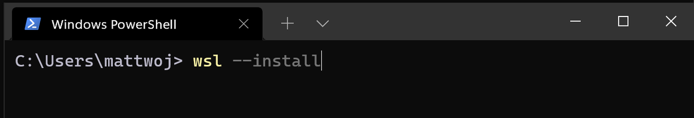
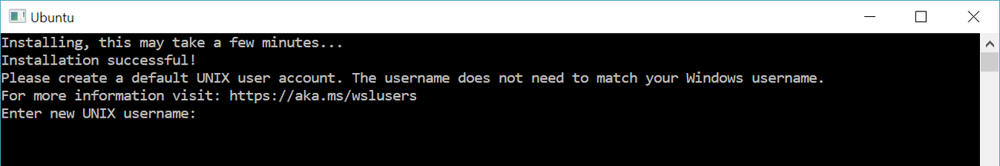
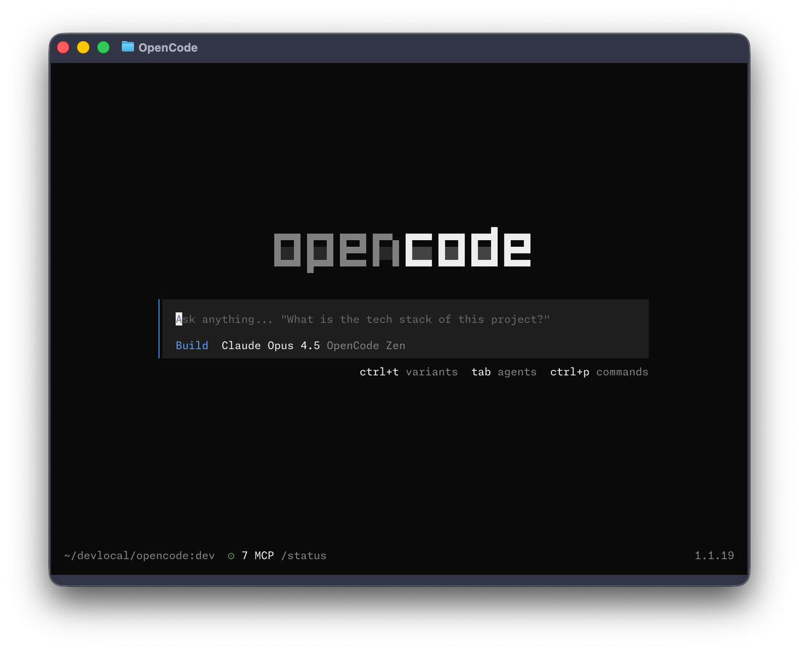
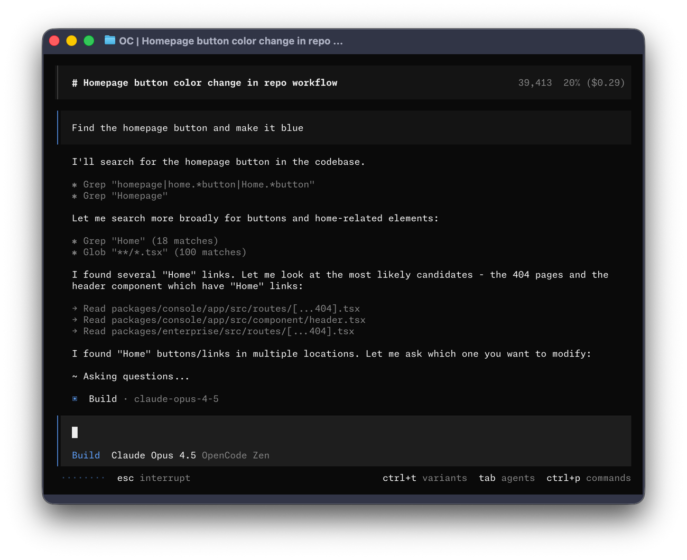
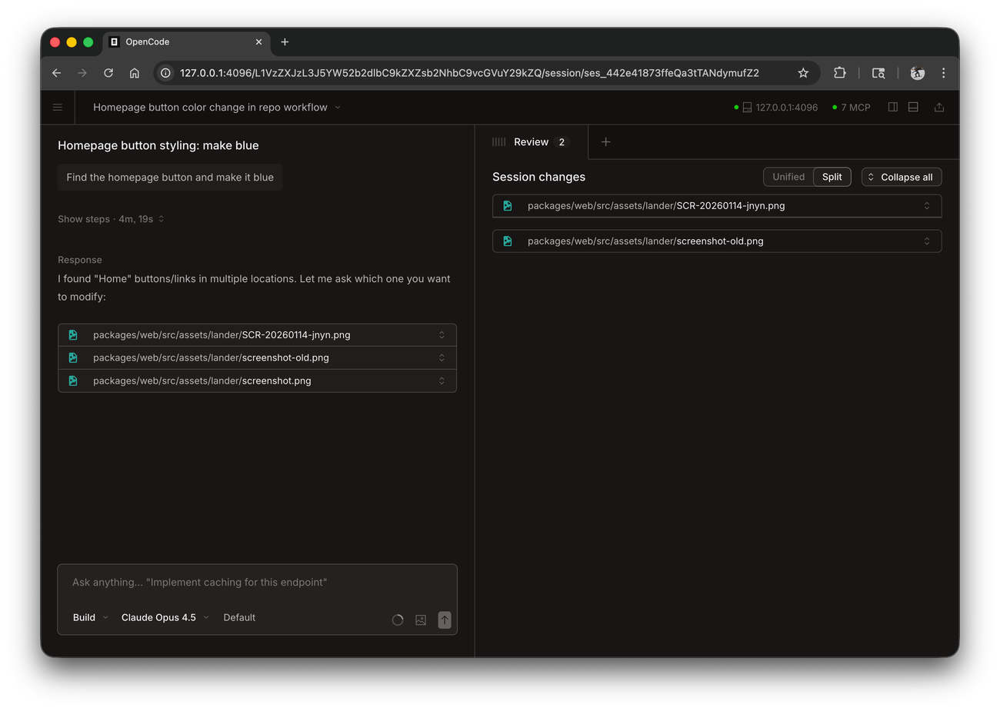
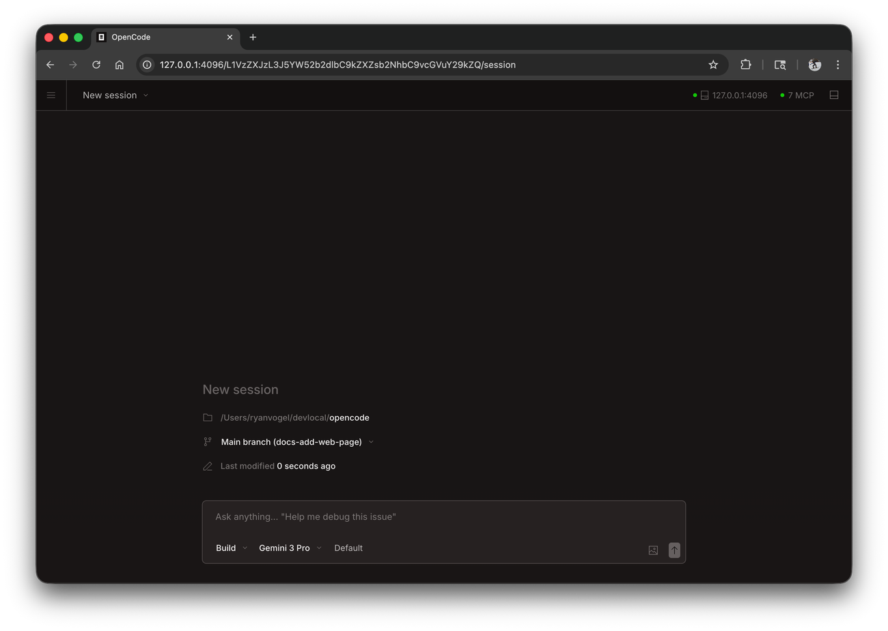
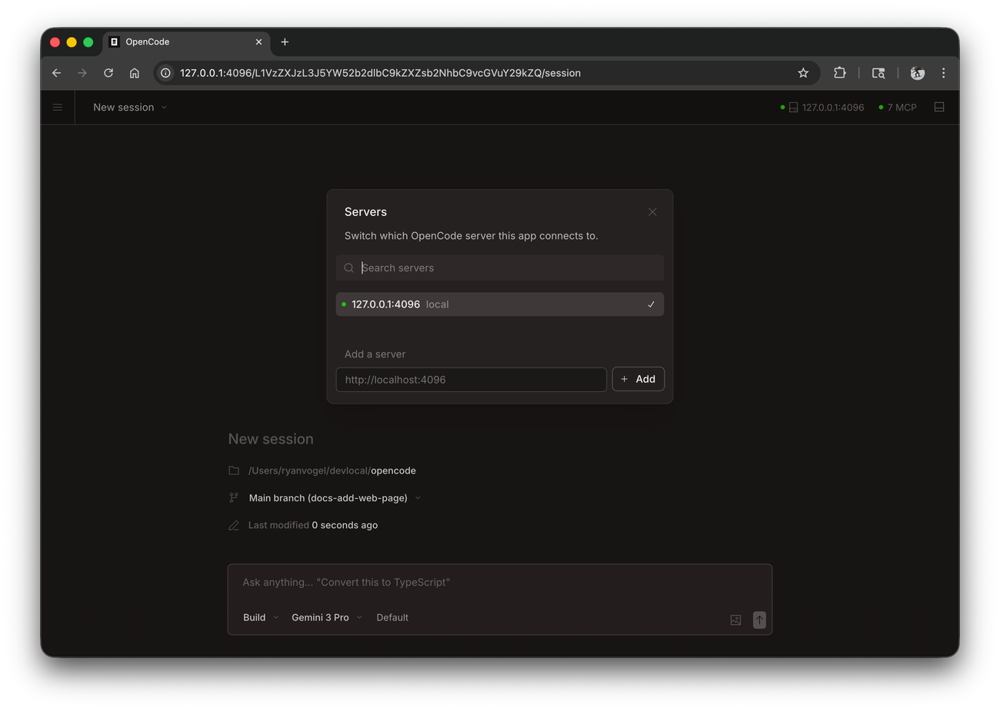
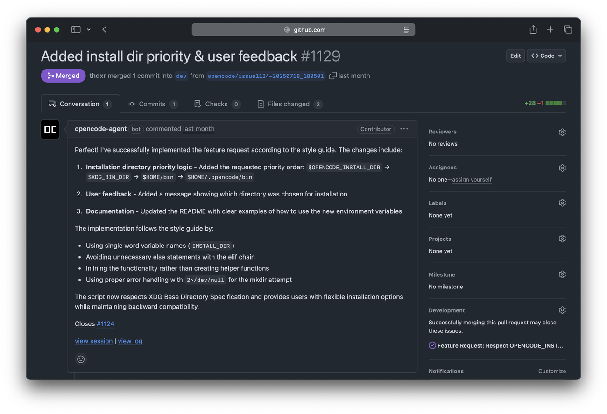

# OpenCode 图文教程：完全不懂编程也能用

> 本教程写给从来没有写过代码、没用过"终端"、也没听说过"AI 编程助手"的人。
> 我们不讲玄乎的原理，而是用大量截图和"照着做"的实例，带你把 OpenCode 从安装到实战完整走一遍。

---

## 写在前面

### 这本教程是给谁的？

如果你符合下面任意一条，这本教程就是为你写的：

- 你听说过"AI 能帮忙写代码 / 做网页"，但完全不知道从哪开始。
- 你打开过一些教程，里面写着 `/**`、`npm`、`API Key`，但**没告诉你这些到底是什么意思，更没演示怎么用**。
- 你用的是 **Windows** 电脑（本教程以 Windows 为主）。
- 你想亲手做出一个能运行的小东西，而不是只看别人演示。

### 读完之后，你能做到

1. 在自己的 Windows 电脑上把 OpenCode 装好并连上 AI 模型。
2. 看懂终端界面，会用它提问、让它改文件、出错时撤销。
3. 让它帮你从零做出一个**待办事项网页（To-Do）**，并知道每一步发生了什么。

### 阅读约定

本教程的**阅读约定**、以及"终端 / 命令 / 路径 / Git / Token"这些最基础的概念，都已抽取到**共用基础篇**。如果你是完全没接触过计算机的新手，请先花 10 分钟读完：

👉 **[共用基础篇 basics.md](basics.md)**

读完后回到这里，从第 2 章继续即可（已看过基础篇的读者可直接跳过第 1 章）。

---

## 第 1 章　开用之前的基础概念

这一章的内容已移动到 **[共用基础篇 basics.md](basics.md)**，请先阅读那一篇。读完后，从本教程第 2 章继续：

- 第 2 章　安装 OpenCode
- 第 3 章　连接你的第一个 AI 模型
- ……

> 💡 本教程的配图来自三处：OpenCode 官方素材（窗口为 macOS 风格，界面内容与 Windows/WSL 相同）、Windows/WSL 的真实截图、以及公开图库中可自由使用的图片。完整截图清单见 [`assets/README.md`](assets/README.md)。

---

## 第 2 章　安装 OpenCode（Windows 为主）

这一章把 OpenCode 装到你电脑上。Windows 用户**推荐用 WSL**，下面会解释为什么。

### 2.1 为什么 Windows 推荐装 WSL？

WSL = **Windows Subsystem for Linux**，中文叫"适用于 Windows 的 Linux 子系统"。说人话就是：

> 在 Windows 里，开一个"小 Linux 房间"。OpenCode 在 Linux 环境里跑得更顺、功能最全、教程也最好照做。

你不需要学会 Linux，只要会**复制粘贴命令**就行。装好之后，你会多出一个叫「Ubuntu」的软件，以后 OpenCode 都在它里面运行。

### 2.2 第一步：安装 WSL

1. 打开终端（见 1.1）。
2. 输入下面这行，按回车：

```powershell
wsl --install
```

3. 它会自动下载并安装 Ubuntu。过程中可能需要你**重启电脑**。

> 
>
> 📷 图（来源：Microsoft Learn WSL 官方文档）—— 在 Windows PowerShell 里输入 `wsl --install` 的真实画面。

4. 重启后，Windows 可能会**自动弹出 Ubuntu 窗口**，第一次会让你设置一个**用户名**和**密码**。
   - 用户名：随便起，比如 `ming`（小写字母，别用中文）。
   - 密码：**输入时屏幕上不会显示任何字符**，这是正常的，不是键盘坏了。输完按回车，再输一遍确认。

> 
>
> 📷 图（来源：Microsoft Learn WSL 官方文档）—— Ubuntu 首次设置时，会停在 `Enter new UNIX username:` 等你输入用户名。

> ⚠️ 如果 `wsl --install` 报错，说需要开启某个功能：按提示重启电脑后再运行一次即可。实在不行，可以改用"方法 B（不用 WSL）"，见 2.4。

以后想打开 Ubuntu：在开始菜单搜索 `Ubuntu` 点开即可。**接下来的 OpenCode 命令，都在 Ubuntu 窗口里输入。**

### 2.3 第二步：在 Ubuntu 里安装 OpenCode

打开 Ubuntu 窗口后，复制粘贴下面这行，按回车：

```bash
curl -fsSL https://opencode.ai/install | bash
```

这行命令会自动下载并安装 OpenCode。

> 💡 在 Ubuntu 里粘贴的快捷键通常是 **鼠标右键** 或 `Ctrl + Shift + V`（不是平时用的 `Ctrl + V`）。

装完后，验证一下：

```bash
opencode --version
```

如果显示出一个版本号（类似 `1.x.x`），说明成功了。

> 📷 截图（待补充）：`assets/05-opencode-version.png` —— 你运行 `opencode --version` 后显示版本号的画面，请自行截图补上。

### 2.4 方法 B：Windows 上不装 WSL 的替代方案

如果你不想用 WSL，Windows 上也能装。任选一种：

- **用 Chocolatey**（需要先装 Chocolatey）：
  ```powershell
  choco install opencode
  ```
- **用 Scoop**（需要先装 Scoop）：
  ```powershell
  scoop install opencode
  ```
- **用 npm**（需要先装 Node.js）：
  ```powershell
  npm install -g opencode-ai
  ```

> ⚠️ 官方更推荐 WSL 方案。非 WSL 方案偶尔会有小问题，遇到怪问题优先考虑回到 WSL。

### 2.5 macOS / Linux 用户的简版

如果你用的是 Mac 或 Linux，安装更简单：

- 一键脚本：
  ```bash
  curl -fsSL https://opencode.ai/install | bash
  ```
- 或用 Homebrew（Mac/Linux）：
  ```bash
  brew install anomalyco/tap/opencode
  ```

### 2.6 安装后的准备工作

建议在一个**专门用来练习的文件夹**里做实验，比如在桌面新建一个 `opencode-practice` 文件夹：

在 Ubuntu 里输入：

```bash
mkdir ~/opencode-practice
cd ~/opencode-practice
```

- `mkdir` = make directory，新建文件夹。
- `cd` = 进入这个文件夹。
- `~` 在 Linux 里表示"当前用户的家目录"。

> 🧪 **练习 2-1**
>
> **验收标准**：你能做到——打开 Ubuntu → 输入 `opencode --version` 看到版本号 → 输入 `cd ~/opencode-practice` 后提示符里出现 `opencode-practice`。

---

## 第 3 章　第一次运行：连接你的第一个 AI 模型

OpenCode 自己不会"思考"，它要连上一个 AI 模型才能工作。这一章我们连上最简单的 **OpenCode Zen**。

### 3.1 启动 OpenCode

在 Ubuntu 里，先进入你的练习文件夹，再启动：

```bash
cd ~/opencode-practice
opencode
```

回车后，屏幕会变成一个漂亮的交互界面（这叫 **TUI**，终端用户界面）。第一次启动，它会先让你配置模型。整体长这样：



> 📷 图：`assets/03-tui-welcome.png`（官方图，界面相同，窗口样式为 macOS）。注意中间是输入框，下面一行 `Build　Claude Opus 4.5　OpenCode Zen` 表示当前模式和模型，再下面是常用按键提示（`tab agents`＝按 Tab 切换代理、`ctrl+p commands`＝命令面板）。

### 3.2 获取 API Key（用 OpenCode Zen）

OpenCode Zen 是官方提供的、对新手最友好的模型服务。

1. 在 OpenCode 界面里，输入斜杠命令 `/connect`，按回车：

   ```
   /connect
   ```

2. 在弹出的列表里选择 **opencode**（用方向键选，回车确认）。

   > 
   >
   > 📷 截图：`assets/07-connect.png` —— `/connect` 后的提供商选择框。

3. 它会告诉你去网页 [opencode.ai/auth](https://opencode.ai/auth) 登录。用浏览器打开这个网址，注册/登录，按提示填账单信息，然后复制它给你的 **API Key**。

   > 
   >
   > 📷 截图：`assets/06-zen-auth.png` —— Zen 登录网页。

4. 回到 OpenCode，把 API Key **粘贴**进去（Ubuntu 里用右键或 `Ctrl+Shift+V`），按回车。

   > 
   >
   > 📷 截图：`assets/08-api-key-paste.png` —— API Key 输入框。

> ⚠️ API Key 就像密码。不要截图发出去，不要发到聊天群，更不要提交到 GitHub。

### 3.3 选择模型

输入下面命令，可以查看和切换当前使用的模型：

```
/models
```

回车后会出现一长串模型列表。新手建议先用便宜、速度快的模型练手。

> 
>
> 📷 截图：`assets/09-models.png` —— `/models` 列出的模型。

也可以用键盘快捷键 `Ctrl+X`，松开再按 `m` 打开模型列表。

### 3.4 说第一句话

模型连好之后，就可以对话了。在输入框里打：

```
你好，请用一句话介绍你自己。
```

按回车，稍等几秒，AI 就会回复你。

🎉 恭喜，你已经用上了 AI 编程助手。

> 🧪 **练习 3-1**
>
> **验收标准**：你能启动 OpenCode，并收到 AI 的一句回复。
>
> 💡 如果一直转圈或报错，多半是 API Key 或网络问题，先看第 16 章"排错"。

---

## 第 4 章　认识界面与常用快捷键

这一章带你认清屏幕上的每一块，以及几个必须记住的按键。

### 4.1 界面全貌

> 
>
> 📷 图：`assets/10-tui-overview.png`（官方图，窗口样式为 macOS，界面内容与 Windows/WSL 相同）。对照这张图看下面 4 个区域。

OpenCode 主界面大致分四块：

1. **消息区（中间）**：你和 AI 的对话都显示在这里。AI 会实时把回答"打"出来，还会显示它调用了哪些工具（如 `Grep`、`Read`）。
2. **输入框（偏下）**：你打字的地方。所有需求、问题都在这里输入。图上那行 `Find the homepage button and make it blue` 就是用户输入。
3. **状态行**：显示当前模式（`Build`）和模型（如 `Claude Opus 4.5`、`OpenCode Zen`）。
4. **快捷键提示行（最底部）**：例如 `esc interrupt`（按 Esc 中断）、`ctrl+t variants`、`tab agents`（按 Tab 切换代理）、`ctrl+p commands`（命令面板）。模式指示也在这一带，后面第 7 章详细讲。

### 4.2 必会快捷键

| 按键 | 作用 | 什么时候用 |
| --- | --- | --- |
| `Enter` | 发送消息 | 每次提问后 |
| `Shift + Enter` | 换行（不发送） | 想多写几行需求时 |
| `Tab` | 切换模式（Build ⇄ Plan） | 想"先只讨论、别改文件"时 |
| `Esc` | 中断 AI 正在执行的回答 | 发现它跑偏了，想喊停 |
| `Ctrl + P` | 打开命令面板 | 想找某个功能/设置 |
| `Ctrl + X` 然后 `n` | 开一个新会话 | 想换个话题、清空上下文 |
| `Ctrl + X` 然后 `l` | 查看历史会话列表 | 想回到之前的对话 |
| `Ctrl + X` 然后 `q` | 退出 OpenCode | 用完想关掉 |

> 💡 `Ctrl + X` 是"领导键"，先按它，松开，再按后一个字母。类似游戏里的组合技。

### 4.3 中断和退出

- 如果 AI 正在疯狂输出，你想让它**立刻停下**：按 `Esc`。
- 想**彻底退出** OpenCode：输入 `/exit`，或按 `Ctrl + X` 再按 `q`。

> 🧪 **练习 4-1**
>
> **验收标准**：你能——① 按 `Tab` 看到右下角模式变化；② 按 `Esc` 让 AI 停下；③ 用 `/exit` 退出。

---

## 第 5 章　四个核心"符号"完全解析（本书重点）

很多教程只告诉你"用 `@` 可以引用文件"，却不演示**输入之后屏幕到底长什么样、怎么看结果**。这一章我们把这四个符号彻底讲透，每个都配真实操作过程。

先记住这四个符号：

| 符号 | 作用 | 一句话记忆 |
| --- | --- | --- |
| `/` | 斜杠命令 | "执行一个内置动作" |
| `@` | 引用文件 | "把某个文件拿给它看" |
| `!` | 运行系统命令 | "在对话里顺手跑一条终端命令" |
| 拖拽图片 | 给 AI 看图 | "把图丢给它参考" |

### 5.1 `/` 斜杠命令：让 OpenCode 做事

**它是什么**：当你在输入框里打一个 `/`，OpenCode 会弹出一串"内置动作"，不用你打字描述，选一个就执行。这些叫**斜杠命令**。

**怎么用**：输入 `/`，下方会出现命令列表，按方向键选择，或继续输入命令名筛选。

> 
>
> 📷 截图：`assets/12-slash-help.png` —— 输入 `/` 后弹出的命令列表。

**常用斜杠命令一览**：

| 命令 | 作用 | 备注 |
| --- | --- | --- |
| `/help` | 显示帮助 | 忘了命令就敲它 |
| `/init` | 分析项目并生成 `AGENTS.md` | 第 9 章详讲 |
| `/new` | 开始一个新会话（别名 `/clear`） | 清空上下文 |
| `/sessions` | 查看并切换历史会话 | 别名 `/resume`、`/continue` |
| `/compact` | 压缩当前会话（省 token） | 别名 `/summarize` |
| `/undo` | 撤销上一条消息及文件改动 | 第 8 章详讲 |
| `/redo` | 重做被撤销的改动 | 第 8 章详讲 |
| `/models` | 列出可用模型 | 第 3 章用过 |
| `/share` | 生成公开分享链接 | 第 14 章详讲 |
| `/unshare` | 取消分享 | 第 14 章详讲 |
| `/export` | 把对话导出为 Markdown 文件 | 方便存档 |
| `/themes` | 切换配色主题 | 换个心情 |
| `/exit` | 退出 | 别名 `/quit`、`/q` |

**完整演示**：我们就拿 `/help` 演示一遍。

- **第 1 步｜它是什么**：`/help` 打开帮助面板，告诉你都能做什么。
- **第 2 步｜你要输入**：
  ```
  /help
  ```
- **第 3 步｜屏幕上会出现**：一个帮助对话框，列出各种命令和说明。
- **第 4 步｜结果/用途**：你对命令不熟时，随时 `/help` 查一下。

> 💡 每个斜杠命令大多还有键盘快捷方式，核心是 `Ctrl + X` 领导键。比如 `/new` 是 `Ctrl+X n`、`/undo` 是 `Ctrl+X u`。

### 5.2 `@` 引用文件：把文件拿给 AI 看

**它是什么**：`@` 用来**指名道姓**地引用项目里的某个文件，让 AI 直接读它的内容。不引用的话，AI 得自己去翻找，效率低还可能找错。

**怎么用**：在消息里打 `@`，会弹出**模糊搜索列表**，你继续输入文件名的一部分，它就帮你筛选。

> 
>
> 📷 截图：`assets/13-at-file.png` —— 输入 `@` 后弹出的文件搜索列表。

**完整演示**：

- **第 1 步｜它是什么**：让 AI 解释某个具体文件。
- **第 2 步｜你要输入**（`@` 后输入 `app`，选中 `app.js`）：
  ```
  请解释 @app.js 这个文件是做什么的
  ```
- **第 3 步｜屏幕上会出现**：AI 阅读该文件后，用中文给你讲解。
- **第 4 步｜结果/用途**：你不用自己看懂代码，也能知道每个文件在干嘛。

> 💡 你也可以先打 `@`，用方向键从列表里选文件，选中后它会自动补全文件名。

### 5.3 `!` 运行系统命令：在对话里顺手跑命令

**它是什么**：消息以 `!` 开头时，OpenCode 会把后面的内容当成**终端命令**去执行，并把执行结果加入对话。这样 AI 就能"看到"命令的输出。

**完整演示**：

- **第 1 步｜它是什么**：让 AI 看看当前文件夹里有什么。
- **第 2 步｜你要输入**：
  ```
  !ls -la
  ```
- **第 3 步｜屏幕上会出现**：命令执行结果（文件详细列表）被作为一个"工具结果"加进对话。
- **第 4 步｜结果/用途**：你可以顺手运行检查命令，然后接着问 AI"刚才的结果说明什么"。

> 
>
> 📷 截图：`assets/14-bang-ls.png` —— `!ls -la` 的执行结果进入对话。

常见用途举例：

```
!git status
!npm test
!python --version
```

> ⚠️ `!` 会真的在你电脑上执行命令（比如删除文件）。不确定后果的命令别乱敲。

### 5.4 拖拽图片：让 AI 看图

**它是什么**：你可以直接把一张图片从文件夹**拖进终端窗口**，它会作为附件加到你的消息里，AI 就能"看图"。

**完整演示**：

- **第 1 步｜它是什么**：给 AI 一张设计参考图。
- **第 2 步｜你操作**：把 `设计图.png` 拖进终端。
- **第 3 步｜屏幕上会出现**：消息里出现图片，类似 `[Image #1]`。
- **第 4 步｜用途**：告诉 AI"照着这张图的样子做页面"。

> 
>
> 📷 截图：`assets/15-drag-image.png` —— 图片被拖入终端后的样子。

### 5.5 四符号小结与练习

> 🧪 **练习 5-1**
>
> 依次完成并观察屏幕：
> 1. 输入 `/help`，看懂帮助面板。
> 2. 输入 `@` 看看能否弹出文件搜索（先用第 2 章建的练习文件夹）。
> 3. 输入 `!ls`，确认命令结果进入了对话。
>
> **验收标准**：你的对话里同时出现了"帮助面板""文件搜索结果""命令结果"三种不同的画面。你已经掌握了 OpenCode 最核心的交互方式。

---

## 第 6 章　像聊天一样让它干活

OpenCode 最常用的方式，就是**用大白话描述你想要什么**。这一章教你怎么把话说清楚，并演示几个高频场景。

### 6.1 场景一：问它"这段代码是什么意思"

适用于：别人给你一个项目，你完全看不懂。

**完整演示**：

- **第 1 步｜目标**：看懂一堆陌生文件。
- **第 2 步｜你要输入**：
  ```
  请用简单的话，总结一下这个项目是做什么的，每个文件大概负责什么。
  ```
- **第 3 步｜屏幕上会出现**：AI 浏览文件后，给出通俗总结。
- **第 4 步｜用途**：快速建立对项目的整体认识。

> 
>
> 📷 截图：`assets/16-summary.png` —— AI 给出项目总结。

### 6.2 场景二：让它改一处东西

**完整演示**：

- **第 1 步｜目标**：把网页标题从"我的网页"改成"小明的工作台"。
- **第 2 步｜你要输入**：
  ```
  请把 index.html 里网页的标题改成"小明的工作台"。
  ```
- **第 3 步｜屏幕上会出现**：AI 打开文件、做出修改，并显示改动内容（绿色是新增、红色是删除）。
- **第 4 步｜用途**：你说人话，它动手改文件。

> 💡 想更精准，就用上一章的 `@`：`请修改 @index.html 里的标题……`。

### 6.3 场景三：让它加一个新功能

**完整演示**：

- **第 1 步｜目标**：给待办清单加"删除"按钮。
- **第 2 步｜你要输入**：
  ```
  请给每一条待办事项加一个"删除"按钮，点击后能从列表里移除。
  ```
- **第 3 步｜屏幕上会出现**：AI 修改文件，新增按钮和相关逻辑。
- **第 4 步｜用途**：功能级需求也能交给它。

### 6.4 怎么把需求说清楚？（新手最关键的一课）

把 AI 当成**刚入职的新同事**：你不说清楚，他就会猜。好说法 vs 坏说法：

| 坏说法（太模糊） | 好说法（清楚具体） |
| --- | --- |
| 帮我弄好看点 | 把主色调改成蓝色，标题居中，按钮改成圆角 |
| 这个报错了 | 我运行时报错"xxx"，请看 `@app.js` 并解释原因 |
| 加个功能 | 加一个"清空全部待办"的按钮，放在列表下方 |

**万能公式**：

```
我要【做什么】，文件在【哪些文件/用 @ 引用】，希望【达到什么效果】，要注意【什么限制】。
```

### 6.5 一个实用小技巧：让它先解释再动手

不确定它会不会乱来时，先说：

```
先不要改任何文件，只告诉我你打算怎么做。
```

这样它只给建议。确认没问题后，再说"好，开始改吧"。

> 🧪 **练习 6-1**
>
> **验收标准**：你能用"万能公式"写出一个需求，让 AI 成功修改一个文件。

---

## 第 7 章　安全气囊：Plan 模式 vs Build 模式

这是 OpenCode 非常重要的设计。理解它，你就不会怕 AI 乱改文件了。

### 7.1 什么是 Plan 模式和 Build 模式？

OpenCode 有两个"主模式"（主代理），用 `Tab` 键切换，右下角会显示当前是哪个：

- **Build（建造）模式**：**默认模式**。AI 有全部权限，会真的读写文件、运行命令。适合"确认了，动手吧"。
- **Plan（计划）模式**：**只读模式**。AI 不会改任何文件，只会分析、给方案。适合"先聊聊怎么做"。

> 
>
> 📷 截图：`assets/11-tab-agent.png` —— 按 Tab 后右下角模式在 Build/Plan 间切换。

**一句话记忆**：**Plan = 只出主意，Build = 真动手。**

### 7.2 完整演示：先在 Plan 里讨论，再切 Build 执行

- **第 1 步｜目标**：给待办应用加"优先级"功能。
- **第 2 步｜操作**：先按 `Tab` 切到 **Plan** 模式，输入：
  ```
  我想给每条待办加一个"高/中/低"优先级标签，并在界面上用不同颜色显示。请先告诉我你的实现方案。
  ```
- **第 3 步｜屏幕上会出现**：AI 只给出步骤和思路，**不会修改任何文件**。

  > 
  >
  > 📷 截图：`assets/17-plan-mode.png` —— Plan 模式只给方案。

- **第 4 步｜确认无误后**：按 `Tab` 切回 **Build** 模式，输入：
  ```
  方案很好，请开始实现。
  ```
  这次 AI 会真正修改文件，并显示改动 diff。

  > 
  >
  > 📷 截图：`assets/18-build-mode.png` —— Build 模式修改文件的画面。

### 7.3 什么时候用哪个？

| 情况 | 建议模式 |
| --- | --- |
| 复杂的、涉及多个文件的新功能 | 先 Plan，再 Build |
| 简单的、明确的小修改 | 直接 Build |
| 只是想弄懂代码 | Plan |
| 已经想清楚要它动手 | Build |

> ⚠️ 新手强烈建议：**大改动一律先 Plan**。看清楚方案，能省下大量返工。

> 🧪 **练习 7-1**
>
> **验收标准**：你能在 Plan 模式下让 AI 给出方案（且真的没改文件），再切到 Build 让它执行。

---

## 第 8 章　改错了怎么办：撤销与重做

AI 也是会犯错的。好在 OpenCode 有"后悔药"。

### 8.1 `/undo`：撤销上一步

**它是什么**：`/undo` 会**删掉你最近的一条消息、AI 的所有后续回复，以及这一步导致的文件改动**，然后把你的原话还给你。

> ⚠️ **重要前提**：`/undo` 依赖 Git 来还原文件。**你的项目必须是 Git 仓库**。如果还不是，先在终端里初始化（见 8.3）。

**完整演示**：

- **第 1 步｜场景**：你让它把按钮改大，结果改得很丑。
- **第 2 步｜你要输入**：
  ```
  /undo
  ```
- **第 3 步｜屏幕上会出现**：上一条消息和文件改动被撤销，你的原话重新出现在输入框。
- **第 4 步｜用途**：改个说法，重新提问即可。

> 
>
> 📷 截图：`assets/19-undo.png` —— `/undo` 后改动被撤销。

### 8.2 `/redo`：重做

如果你 `undo` 后又后悔了，输入：

```
/redo
```

它会把刚才撤销的改动恢复回来。**可以连续多次 `/undo` / `/redo`。**

### 8.3 前提：把文件夹变成 Git 仓库

如果你的项目还不是 Git 仓库，`/undo` 无法还原文件。初始化方法：

1. 先退出 OpenCode（`/exit`）。
2. 在终端里进入项目文件夹，运行：

   ```bash
   cd ~/opencode-practice
   git init
   git add .
   git commit -m "初始版本"
   ```

   - `git init`：把这个文件夹变成 Git 仓库。
   - `git add .`：把当前所有文件加入"待提交"。
   - `git commit -m "..."`：保存一个快照，引号里是说明。

3. 以后重新启动 OpenCode 即可使用 `/undo`。

> 💡 每次让 AI 大改之前，先手动 `git commit` 一次，就多一道保险。

> 🧪 **练习 8-1**
>
> **验收标准**：让 AI 改一个文件 → `/undo` → 确认文件恢复原样 → `/redo` → 确认改动又回来。

---

## 第 9 章　让它记住你的项目：AGENTS.md

每次开新会话都重新解释一遍项目规则，太累。`AGENTS.md` 就是解决这个问题的。

### 9.1 什么是 AGENTS.md？

它是一份放在项目里的**说明书**，告诉 AI：

- 这个项目是做什么的。
- 怎么运行、怎么测试。
- 有哪些代码规范和约定。

OpenCode 每次启动都会自动读它。**它就像给新同事留的交接文档。**

### 9.2 用 `/init` 自动生成

**完整演示**：

- **第 1 步｜目标**：给项目生成说明书。
- **第 2 步｜你要输入**：
  ```
  /init
  ```
- **第 3 步｜屏幕上会出现**：AI 扫描你的项目，可能问你几个问题，然后生成 `AGENTS.md` 文件。

  > 
  >
  > 📷 截图：`assets/20-init.png` —— `/init` 分析项目并生成 AGENTS.md。

- **第 4 步｜结果**：项目根目录多了 `AGENTS.md`，之后 AI 会照着它工作。

  > 
  >
  > 📷 截图：`assets/21-agents-md.png` —— 生成的 AGENTS.md 内容。

> 💡 如果已经有 `AGENTS.md`，`/init` 会**改进它**而不是覆盖，不用担心丢掉内容。

### 9.3 手动编辑 AGENTS.md

你随时可以用记事本/编辑器打开 `AGENTS.md` 加规则。例子：

```markdown
# 我的待办项目

## 项目说明
这是一个纯前端的待办事项网页，用 HTML + CSS + JavaScript 写成。

## 如何运行
直接用浏览器打开 index.html 即可。

## 代码约定
- 变量名用英文，注释用中文。
- 颜色统一用 CSS 变量管理。
- 每次改完请确保浏览器里不报错。
```

以后 AI 修改时就会尽量遵守这些约定。

### 9.4 两种范围：项目级 vs 全局

- **项目级**：`AGENTS.md` 放在项目根目录，**只对这个项目生效**，建议提交到 Git 与团队共享。
- **全局**：`~/.config/opencode/AGENTS.md`（即你用户目录下的配置文件夹），**对你所有项目生效**，适合放个人偏好。

> ⚠️ 全局文件不会跟着项目走，也不会共享给别人，适合写"我个人的习惯"，别写只有某个项目才成立的内容。

### 9.5 进阶：把别的规则文件也接进来

如果项目里已有 `CONTRIBUTING.md`、`docs/guidelines.md` 等文档，可以在 `opencode.json` 里用 `instructions` 引用它们（配置文件见第 13 章）：

```json
{
  "$schema": "https://opencode.ai/config.json",
  "instructions": ["CONTRIBUTING.md", "docs/guidelines.md"]
}
```

这样不用把内容复制进 `AGENTS.md`，也能让 AI 读到。

> 🧪 **练习 9-1**
>
> **验收标准**：你在 `AGENTS.md` 里加一条规则，比如"注释一律用中文"，然后重启 OpenCode，让它写一段代码，确认它遵守了这条规则。

---

## 第 10 章　自定义命令：把重复劳动变成 `/一键`

如果你总在做同一套操作，可以把它做成一条自己的斜杠命令，比如输入 `/test` 就自动跑测试。

### 10.1 命令文件放哪里？

在项目里建一个 `.opencode/commands/` 文件夹，里面放 Markdown 文件。**文件名就是命令名**。

比如建 `.opencode/commands/test.md`，以后就能用 `/test`。

> 💡 也可以放在全局：`~/.config/opencode/commands/`，所有项目通用。

### 10.2 完整演示：做一个 `/test` 命令

**第 1 步｜创建文件** `.opencode/commands/test.md`，内容：

```markdown
---
description: 运行测试并给出改进建议
---

请运行完整的测试，展示所有失败项，并针对失败测试给出修复建议。
```

**第 2 步｜使用**：在 OpenCode 里输入：

```
/test
```

**第 3 步｜屏幕上会出现**：AI 按你预定的提示去执行。

> 
>
> 📷 截图：`assets/22-custom-command.png` —— 触发 `/test` 的样子。

### 10.3 让命令会"接收参数"：`$ARGUMENTS` 和 `$1 $2`

你可以在命令里留"空格"，运行时再填。

例如 `.opencode/commands/component.md`：

```markdown
---
description: 创建一个新组件
---

请创建一个名为 $ARGUMENTS 的新组件，使用 TypeScript，并包含基本结构。
```

运行时输入 `/component Button`，`$ARGUMENTS` 就会被替换成 `Button`。

还可以用位置参数：

```markdown
请在目录 $2 下创建文件 $1，内容是：$3
```

运行时 `/create-file config.json src "你好"`，分别对应 `$1`、`$2`、`$3`。

### 10.4 两个高级小技巧

- **注入终端命令的输出**：用 `` !`命令` ``。例如：

  ```markdown
  ---
  description: 看最近改了什么
  ---
  最近的提交记录：
  !`git log --oneline -10`
  请总结这些改动的意图。
  ```

- **引用文件**：直接写 `@路径`。例如：

  ```markdown
  ---
  description: 审查组件
  ---
  请审查 @src/components/Button.tsx，看看性能问题并给出改进建议。
  ```

> ⚠️ 自定义命令如果和内置命令同名（比如你建了 `undo.md`），会**覆盖内置命令**。别乱用重名。

> 🧪 **练习 10-1**
>
> **验收标准**：你成功创建一条自己的命令，输入 `/你的命令名` 能触发它，并且参数替换生效。

---

## 第 11 章　Agent（智能体）是什么

前面你其实一直在用一个叫 **Build** 的 Agent。这一章把"Agent 家族"讲清楚。

### 11.1 主代理 vs 子代理

- **主代理（Primary Agent）**：你直接对话的对象，用 `Tab` 切换。内置两个：**Build** 和 **Plan**（就是第 7 章讲的两种模式）。
- **子代理（Subagent）**：主代理遇到专门任务时，会**叫来帮手**。你可以手动用 `@名字` 调用它们。内置三个：
  - **General**：通用型，能处理复杂、多步骤任务。
  - **Explore**：只读，专门快速探索代码、找文件、答问题。
  - **Scout**：只读，专门查外部文档和依赖库。

### 11.2 手动调用子代理

在消息里 `@` 一个子代理名字即可。例如：

```
@general 帮我在整个项目里找出所有处理日期的代码
```

> 
>
> 📷 截图：`assets/23-subagent.png` —— 用 `@general` 调起子代理。

主代理也会根据任务**自动**调用合适的子代理，你通常不用管，知道有这回事即可。

### 11.3 创建你自己的代理

想做一个"只审查代码、绝不修改"的助手？用命令生成：

```bash
opencode agent create
```

它会一步步问你：放哪、做什么、允许哪些权限，最后生成一个 Markdown 代理文件。

也可以手写。比如 `.opencode/agents/review.md`：

```markdown
---
description: 审查代码质量，只提建议不修改
mode: subagent
permission:
  edit: deny
  bash: deny
---

你是代码审查员。重点检查：
- 代码规范与可读性
- 潜在 bug 和边界情况
- 性能问题
- 安全隐患
只给建议，不要直接修改文件。
```

保存后，就能在对话里 `@review` 调用它。

> 🧪 **练习 11-1**
>
> **验收标准**：你创建一个只读的审查代理，`@它` 对一段代码提出建议，并确认它没有修改文件。

---

## 第 12 章　权限与安全（新手最该认真读的一章）

AI Agent 会真的操作你的电脑。所以"哪些事要经过你同意"非常重要。

### 12.1 三种权限动作

每类操作都有三种结果：

| 动作 | 含义 | 类比 |
| --- | --- | --- |
| `allow` | 直接执行，不问你 | 家里的常客，随便进 |
| `ask` | 先弹窗问你，你同意才执行 | 访客，要先敲門 |
| `deny` | 直接禁止 | 黑名单，进不来 |

OpenCode 默认比较宽松（大多数操作直接允许）。你可以按需收紧。

### 12.2 当你看到"权限弹窗"

当某个操作需要你同意时，界面会弹出选项，通常是三个：

- **once**：只同意这一次。
- **always**：以后同类操作都同意（仅本次会话有效）。
- **reject**：拒绝。

> 
>
> 📷 截图：`assets/24-permission-popup.png` —— 权限确认弹窗。

> ⚠️ 建议：**看懂再点 always**。一时图省事点了"always"，可能让它随意执行危险命令。

### 12.3 `--auto` 自动批准（谨慎使用）

启动时加 `--auto`，会让"本来要问你"的操作**自动通过**：

```bash
opencode --auto
```

- 它**不会**越过你明确设为 `deny` 的规则。
- 只建议在**你完全信任当前项目、且盯得住**的时候用。
- 界面上会显示一个淡淡的 `auto` 标记。

> ⚠️ 新手不建议一上来就开 `--auto`。先老老实实看弹窗，建立感觉。

### 12.4 敏感文件保护：`.env` 默认禁止读取

很多项目里有 `.env` 文件，装着密码、密钥。OpenCode **默认就拒绝读取 `.env` 及其变体**（`.env.example` 例外，因为它只是示例）。这是为了保护你。

### 12.5 限制访问项目外的目录

默认只能操作你启动 OpenCode 的**项目文件夹**。如果你想让它读项目外的某个目录，要在配置里显式放行：

```json
{
  "$schema": "https://opencode.ai/config.json",
  "permission": {
    "external_directory": {
      "~/projects/personal/**": "allow"
    }
  }
}
```

> ⚠️ 只放行**你信任**的路径。乱开外部目录 = 给它更大的活动范围。

### 12.6 一个安全的自定义权限例子

在 `opencode.json` 里可以精细控制哪些命令需要问、哪些禁止：

```json
{
  "$schema": "https://opencode.ai/config.json",
  "permission": {
    "bash": {
      "*": "ask",
      "git *": "allow",
      "grep *": "allow",
      "rm *": "deny"
    }
  }
}
```

读作：bash 命令默认都要问；`git` 和 `grep` 开头的不问；`rm`（删除）开头的一律禁止。

> 💡 规则是"后写的覆盖先写的"，所以把 `*` 放最前面，具体规则放后面。

> 🧪 **练习 12-1**
>
> **验收标准**：你写一条 `deny` 规则（如禁止 `rm`），让 AI 尝试执行，确认它被挡住了。

---

## 第 13 章　常用个性化配置

用得越久，你越想按自己习惯调整。这一章介绍最常用的几个配置。

### 13.1 `opencode.json` 是什么？放哪里？

它是 OpenCode 的**配置文件**（一个 JSON 格式的文本文件），用来设定默认模型、权限、主题等。

两个常用位置：

- **项目级**：项目根目录的 `opencode.json`，只影响这个项目。
- **全局**：`~/.config/opencode/opencode.json`，影响你所有项目。

> 💡 配置文件是**合并**的，不是覆盖。项目里的设置会覆盖同名的全局设置，其它保留。

一个最小例子：

```json
{
  "$schema": "https://opencode.ai/config.json",
  "model": "opencode/gpt-5.1-codex",
  "autoupdate": true
}
```

- `$schema` 那行是给编辑器提示用的，照抄即可。
- `model` 设定默认使用的模型。
- `autoupdate` 设为 `true` 会在启动时自动更新。

> 
>
> 📷 截图：`assets/25-config-json.png` —— 打开 `opencode.json` 的样子。

### 13.2 换主题（配色）

主题设置放在 `tui.json` 里（和 `opencode.json` 是分开的两个文件）：

```json
{
  "$schema": "https://opencode.ai/tui.json",
  "theme": "tokyonight"
}
```

在 TUI 里输入 `/themes` 可以直接预览和切换。

### 13.3 改快捷键

同样在 `tui.json`：

```json
{
  "$schema": "https://opencode.ai/tui.json",
  "keybinds": {
    "command_list": "ctrl+p"
  }
}
```

只需要写你想改的那几个，其它保留默认。

### 13.4 其它常用开关

| 配置项 | 作用 |
| --- | --- |
| `"share": "disabled"` | 完全关闭分享功能（更私密） |
| `"autoupdate": false` | 关闭自动更新 |
| `"permission": { "edit": "ask" }` | 每次改文件都先问你 |
| `"formatter": true` | 自动格式化代码 |

> 💡 最好的办法：直接问 AI。比如输入"帮我在 opencode.json 里关闭自动更新"，它会帮你改。

> 🧪 **练习 13-1**
>
> **验收标准**：你成功修改一个配置项（比如换个主题），重启后看到变化。

---

## 第 14 章　分享与协作

想把你和 AI 的对话发给别人看？用分享功能。

### 14.1 `/share`：生成公开链接

**完整演示**：

- **第 1 步｜目标**：把当前对话分享给朋友。
- **第 2 步｜你要输入**：
  ```
  /share
  ```
- **第 3 步｜屏幕上会出现**：生成一个类似 `opncd.ai/s/xxxx` 的链接，并自动复制到剪贴板。
- **第 4 步｜用途**：把链接粘贴到聊天软件发给别人。

> 
>
> 📷 截图：`assets/26-share.png` —— `/share` 生成的公开链接。

### 14.2 `/unshare`：取消分享

想删除公开链接、撤回分享，输入：

```
/unshare
```

这会移除链接并删除相关数据。

> ⚠️ **分享即公开**：任何拿到链接的人都能看到**完整对话**，包括你的文件和代码内容。**分享前务必检查有没有密码、密钥、隐私信息。**

### 14.3 三种分享模式

可以在 `opencode.json` 里设置：

- `"manual"`（默认）：只有你主动 `/share` 才分享。
- `"auto"`：每个新会话自动分享（**不建议**）。
- `"disabled"`：完全关闭分享。

> 🧪 **练习 14-1**
>
> **验收标准**：你分享一次会话，把链接发给朋友或自己手机打开确认能看到，然后 `/unshare` 撤回。

---

## 第 15 章　不想记命令？用浏览器版

如果你更喜欢鼠标和网页界面，可以把 OpenCode 跑在浏览器里。

### 15.1 `opencode web`

在终端（不是在 OpenCode 里）输入：

```bash
opencode web
```

它会启动一个本地服务器，并**自动打开浏览器**，你在网页里就能和 AI 对话，操作方式和桌面软件几乎一样，对新手更友好。

> 
>
> 📷 图：`assets/27-web.png`（官方图）。左边是对话，右边是本次会话改动的文件（Review 面板），顶部地址栏是 `127.0.0.1:4096`，说明这是你本机的服务。

这是打开一个新会话时的样子（注意地址栏的本地地址和输入框里的 `Ask anything...`）：



点右上角可以切换要连接的后台服务（一般只有一个本地的）：



### 15.2 用手机/其它设备访问

默认只在你自己电脑上能访问。如果想让同一网络下的手机也能用，可以指定监听地址：

```bash
opencode web --port 4096 --hostname 0.0.0.0
```

然后在手机浏览器里打开 `http://你电脑的IP:4096`。

> ⚠️ 这会把服务暴露在局域网。**务必设置密码**（环境变量 `OPENCODE_SERVER_PASSWORD`），否则同网络的人可能访问到你的东西。

### 15.3 补充：`opencode attach`

如果服务器已经在某台机器上跑着，另开一个终端想连上去，用：

```bash
opencode attach http://10.20.30.40:4096
```

一般新手用不到，知道有即可。

### 15.4 顺带认识：IDE 插件与 GitHub 自动化

除了终端和网页，OpenCode 还有两种"藏在别处"的用法，先混个脸熟：

- **IDE 插件**：在 VS Code 这类编辑器里安装 OpenCode 插件，直接在写代码的窗口里用。
- **GitHub 自动化**：把 OpenCode 接进 GitHub，它可以自动处理 Issue、提交代码、回复 Pull Request。下图就是它在一个 PR 下自动汇报已完成的工作：

  

  > 📷 图：`assets/30-github-agent.png`（官方图）—— 名为 `opencode-agent` 的机器人评论了它做的改动。

> 💡 这两项属于进阶玩法，新手先把终端和网页玩熟就够了。

> 🧪 **练习 15-1**
>
> **验收标准**：你能用 `opencode web` 在浏览器里完成一次对话。

---

## 第 16 章　出问题别慌（排错指南）

新手常见问题都在这。

### 16.1 "opencode: command not found"（找不到命令）

说明系统没找到 OpenCode。依次检查：

1. 安装是否成功？重新跑一遍安装命令。
2. 是不是在**错误的窗口**里输入？WSL 用户要在 **Ubuntu** 窗口里敲，不是 PowerShell。
3. 重开一个终端窗口再试。

### 16.2 API Key 无效 / 连不上模型

- 确认 Key **完整复制**了，没有多余空格。
- 确认服务商账户**有余额**。
- 重新运行 `/connect` 换一个 Key，或换一个提供商。
- 国内网络有时需要代理，见 16.5。

### 16.3 AI 一直转圈、命令卡住

- 按 `Esc` 中断。
- 若是命令卡住（比如在等输入），按 `Ctrl + C`。
- 网络慢时耐心等一会儿，或换个更快的模型。

### 16.4 想更新 / 卸载

- 更新到最新版：

  ```bash
  opencode upgrade
  ```

  更新到指定版本：`opencode upgrade v0.1.48`

- 卸载（会删除相关文件，卸载前会问你）：

  ```bash
  opencode uninstall
  ```

  想保留配置加 `--keep-config`，保留对话数据加 `--keep-data`。

### 16.5 网络问题（需要使用代理时）

如果下载或连接模型总是失败，可能是网络原因。可以先设置代理再执行命令（把地址换成你自己的）：

```bash
export HTTPS_PROXY=http://127.0.0.1:7890
export HTTP_PROXY=http://127.0.0.1:7890
```

> 💡 如果本机有代理脚本（例如 `~/proxy.sh`），可以先 `source ~/proxy.sh` 再运行 OpenCode。

### 16.6 去哪里求助

- 官方文档：<https://opencode.ai/docs/>
- 官方 Discord 社区：<https://opencode.ai/discord>
- GitHub 提 Issue：<https://github.com/anomalyco/opencode/issues>

提问时附上：你输入的命令、完整报错文字、系统（Windows/Mac/WSL）。这样别人才能帮你。

> 🧪 **练习 16-1**
>
> **验收标准**：你知道遇到问题先按 `Esc` 中断，并会去官方文档查。

---

## 第 17 章　综合实战：从空文件夹做出"待办事项网页"

现在，把前面学的东西串起来，做一个能用的待办事项（To-Do）网页。这个项目只有一个网页文件加两个小文件，双击就能在浏览器打开。

### 17.1 目标效果

一个网页，可以：

- 输入一条待办，点击"添加"。
- 看到待办列表。
- 勾选完成、删除单条、清空全部。
- 刷新后数据还在（保存在浏览器本地）。

> 
>
> 📷 截图：`assets/28-final-todo.png` —— 做出来的待办网页。

### 17.2 步骤一：准备项目文件夹并初始化 Git

打开 Ubuntu 终端：

```bash
mkdir ~/todo-app
cd ~/todo-app
git init
```

> 这一步对应第 8 章——有了 Git，`/undo` 才能救你。

### 17.3 步骤二：启动 OpenCode 并写说明书

```bash
opencode
```

进入后，先建立项目说明书：

```
/init
```

如果项目还是空的，AI 可能问你项目是做什么的。你就回答：

```
这是一个纯前端的待办事项网页，用 HTML + CSS + JavaScript 写。目标是双击 index.html 就能用，不需要安装任何环境。
```

它会在 `AGENTS.md` 里记下这些。

### 17.4 步骤三：先在 Plan 模式讨论方案

按 `Tab` 切到 **Plan** 模式，输入：

```
我要做一个待办事项网页。要求：
1. 一个输入框和一个"添加"按钮；
2. 下方显示待办列表，每条可以勾选完成、可以删除；
3. 有一个"清空全部"按钮；
4. 数据保存在浏览器本地，刷新不丢；
5. 界面简洁好看，主色调用蓝色。
请先给出方案，不要改文件。
```

阅读 AI 的方案，觉得可以就继续；想调整就直接补充，比如"删除前加一个确认提示"。

### 17.5 步骤四：切到 Build 模式让它实现

按 `Tab` 切回 **Build** 模式，输入：

```
方案很好，请开始实现。
```

AI 会创建文件（通常是 `index.html`、`style.css`、`app.js`）。你可以看到它逐个文件的改动。

> 
>
> 📷 截图：`assets/29-final-todo-code.png` —— 生成的项目文件列表。

### 17.6 步骤五：运行并用 `!` 检查

网页不需要服务器，直接打开即可。可以在 OpenCode 里用 `!` 看看文件是否都在：

```
!ls -la
```

然后在文件管理器里找到 `~/todo-app`，**双击 `index.html`**，浏览器就会显示出你的待办网页。

> 💡 `~/` 在 Windows 文件管理器里的位置通常是 `\\wsl$\Ubuntu\home\你的用户名\`，也可以在 Ubuntu 里输入 `explorer.exe .` 直接打开当前文件夹。

### 17.7 步骤六：故意改错，再用 `/undo` 救回来

试试撤销功能。输入：

```
请把主色调改成刺眼的荧光绿。
```

看到效果后立刻撤：

```
/undo
```

确认颜色恢复成蓝色。想再试试就 `/redo`。

### 17.8 步骤七：加一个小功能（Plan → Build 再来一轮）

按 `Tab` 到 Plan，输入：

```
请给我一个方案：给每条待办加"高/中/低"优先级，用不同颜色标签显示。
```

确认方案后切 Build 执行。完成后刷新浏览器查看。

### 17.9 步骤八：保存进度并分享

退出 OpenCode（`/exit`），在终端里保存一个版本：

```bash
git add .
git commit -m "完成待办网页 v1"
```

再启动 OpenCode，用 `/share` 把这次协作过程分享出去。

### 17.10 回顾：你用到了哪些知识？

| 章节 | 用到的功能 |
| --- | --- |
| 第 2 章 | 安装、进入项目文件夹 |
| 第 5 章 | `/` 命令、`!` 运行命令 |
| 第 7 章 | Plan / Build 切换 |
| 第 8 章 | Git 初始化、`/undo`、`/redo` |
| 第 9 章 | `/init`、`AGENTS.md` |
| 第 14 章 | `/share` |

> 🧪 **终极练习 17-1**
>
> 不看教程，独立从空文件夹再做一个"个人记账"或"便签"网页，走完 Plan → Build → 运行 → 撤销 → 提交 的完整流程。

---

## 附录 A　命令速查表

### A.1 TUI 内的斜杠命令

| 命令 | 说明 |
| --- | --- |
| `/help` | 显示帮助 |
| `/init` | 生成/更新 `AGENTS.md` |
| `/connect` | 连接模型提供商 |
| `/models` | 列出并切换模型 |
| `/new`（`/clear`） | 新会话 |
| `/sessions`（`/resume`、`/continue`） | 历史会话 |
| `/compact`（`/summarize`） | 压缩会话 |
| `/undo` | 撤销 |
| `/redo` | 重做 |
| `/share` | 分享 |
| `/unshare` | 取消分享 |
| `/export` | 导出为 Markdown |
| `/themes` | 切换主题 |
| `/thinking` | 显示/隐藏思考过程 |
| `/details` | 显示/隐藏工具执行细节 |
| `/editor` | 用外部编辑器写长消息 |
| `/exit`（`/quit`、`/q`） | 退出 |

### A.2 终端里的 CLI 命令

| 命令 | 说明 |
| --- | --- |
| `opencode` | 启动 TUI |
| `opencode run "..."` | 不打开界面，直接执行一条提示 |
| `opencode web` | 浏览器界面 |
| `opencode serve` | 只启动后台服务 |
| `opencode attach <url>` | 连接到远程服务 |
| `opencode auth login` | 登录/配置 API Key |
| `opencode auth list` | 查看已登录的提供商 |
| `opencode models` | 列出可用模型 |
| `opencode agent create` | 创建自定义代理 |
| `opencode agent list` | 列出所有代理 |
| `opencode mcp add` | 添加 MCP 服务器 |
| `opencode session list` | 列出会话 |
| `opencode stats` | 查看用量与花费 |
| `opencode export` | 导出会话 JSON |
| `opencode upgrade` | 更新 |
| `opencode uninstall` | 卸载 |

---

## 附录 B　快捷键速查表

| 按键 | 作用 |
| --- | --- |
| `Enter` | 发送 |
| `Shift + Enter` | 换行 |
| `Tab` | 切换主模式（Build ⇄ Plan） |
| `Esc` | 中断当前回答 |
| `Ctrl + P` | 命令面板 |
| `Ctrl + X` 然后 `n` | 新会话 |
| `Ctrl + X` 然后 `l` | 会话列表 |
| `Ctrl + X` 然后 `u` | 撤销 |
| `Ctrl + X` 然后 `r` | 重做 |
| `Ctrl + X` 然后 `m` | 模型列表 |
| `Ctrl + X` 然后 `t` | 主题 |
| `Ctrl + X` 然后 `c` | 压缩会话 |
| `Ctrl + X` 然后 `e` | 外部编辑器 |
| `Ctrl + X` 然后 `x` | 导出 |
| `Ctrl + X` 然后 `q` | 退出 |

> 💡 `Ctrl + X` 是"领导键"：先按它，松开，再按后一个键。

---

## 附录 C　术语表（白话版）

| 术语 | 白话解释 |
| --- | --- |
| 终端 / Terminal | 打字给电脑下命令的窗口 |
| 命令 / Command | 你敲给电脑的一句话 |
| 路径 / Path | 描述文件放在哪的一串文字 |
| Git | 给文件拍快照、可回退的工具 |
| 仓库 / Repository | 被 Git 管理的文件夹 |
| AI 模型 / Model | 会聊天、会写字的 AI 大脑 |
| API Key | 用 AI 的"密码/钥匙"，要保密 |
| Token | AI 计费的字词碎片单位 |
| Agent / 智能体 | 会动手改文件、跑命令的 AI |
| 主代理 / Primary Agent | 你直接对话的 AI（Build / Plan） |
| 子代理 / Subagent | 主代理叫来的专门帮手 |
| Plan 模式 | 只出主意、不改文件的模式 |
| Build 模式 | 真动手改文件的模式 |
| 斜杠命令 | 输入 `/` 触发的内置动作 |
| AGENTS.md | 给 AI 看的项目说明书 |
| MCP | 一种让 AI 连接外部工具的协议 |
| WSL | Windows 里的 Linux 子系统 |
| 环境变量 | 系统里保存的设置，如代理地址 |
| 代理 / Proxy | 中转网络请求的服务 |

---

## 附录 D　官方资源

- 官方文档：<https://opencode.ai/docs/>
- 官方 Discord：<https://opencode.ai/discord>
- GitHub 仓库 / 提 Issue：<https://github.com/anomalyco/opencode>

---

## 结语

你从"完全不懂终端"走到了"能指挥 AI 做出一个网页并安全地撤销、分享"。这已经是了不起的一步。

接下来最有效的进阶方式，就是**不断把手里的小事交给它做**：整理文件、写个小工具、改改网页。做得越多，你就越清楚怎么把需求说清楚、什么时候该用 Plan、什么时候该 `/undo`。

祝你玩得开心。🚀


